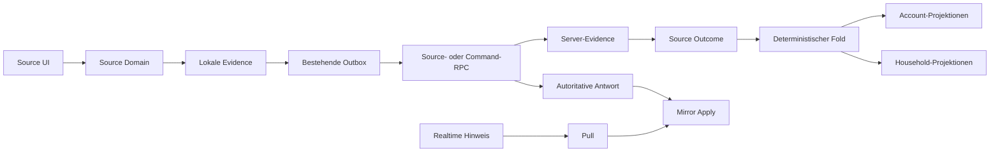

Dieses Dokument definiert den umsetzbaren Architekturvertrag für Gamification Release 1. Es bindet jede Fachregel an Owner, Daten, Sync und Tests.

# Technisches Design: Gamification Release 1

- Status: Technisches Design, keine Implementierung.
- Maßgebliche Fachquelle: `.kiro/specs/gamification/requirements.md`.
- Technische Prüfquellen: beide Designplan-Reviews.
- Änderungsgrenze: Diese Phase ändert nur dieses Dokument.
- Ist-Spitze bei Erstellung: `origin/main` auf `3d27a98a`.

## 1. Ziel und Grenzen

Release 1 verarbeitet genau sechs Source Outcomes.
Fünf Outcomes gehören einem Household.
Ein Outcome gehört ausschließlich einem erwachsenen Account.

| Scope | Source Type | Source Completion ID | Data Owner |
| --- | --- | --- | --- |
| Household | `cooking_session_completed` | Cooking Session ID | Household |
| Household | `shopping_run_completed` | Shopping Run ID | Household |
| Household | `meal_plan_completed` | Serververgebene Meal Plan Completion ID | Household |
| Household | `inventory_consumed` | Consume Operation ID | Household |
| Household | `recipe_contributed` | Recipe Publication ID | Household |
| Account | `private_meal_log_saved` | Meal-Log-ID | Account |

Release 1 enthält diese Projektionen:

- Persönliche XP.
- Persönliche Achievements.
- Private Challenges.
- Household Challenges.
- Persönliche Streaks und Protected Days.
- Household-Wochenfortschritt ohne sichtbare Mitgliedzuordnung.
- Eine private Legacy-Startmarke.
- Installationslokales Completion Feedback.

Diese Daten erzeugen niemals Gamification:

- Gewicht.
- Workouts.
- Fasten.
- Medikamente, Symptome, Vitalwerte und Wassertracking.
- Kind-Tracking und jeder Datensatz mit `child_profile_id`.
- App-Öffnungen, Screen Views, Navigation und Taps.
- Lokaler UI-Zustand und Telemetrie.
- Ranglisten, Level, monetäre Belohnungen und Household Achievements.

App-Öffnungen bleiben reine Analytics-Signale.
Analytics und Gamification besitzen getrennte Schreibpfade.

## 2. Architekturentscheidungen

Dieses Design trifft neun verbindliche Entscheidungen.
Sie schließen die Blocker aus dem letzten Review.

| Pflichtpunkt | Verbindliche Entscheidung | Owner |
| --- | --- | --- |
| Accountweiter Sync | Ein Account-Runner läuft mit null bis vielen Households. | `src/lib/sync/sync-runner.ts` |
| Kontrollierte Servergrenze | PostgreSQL-Funktionen besitzen Befehle und Transaktionen. | Deklaratives Supabase-Schema |
| Serverrevisionen | Spezialisierte Apply-Regeln ersetzen Zeitstempelvergleiche. | `src/lib/sync/mirror-write.ts` |
| Offline-Meal-Plan-ID | `operation_id` bleibt lokal vorläufig. Der Server liefert die endgültige ID. | Meal-Plan-RPC und lokaler Adapter |
| Dauerhafte Evidence | Jede Source Domain besitzt ihre Evidence und Gegenaktion. | Sechs Source Domains |
| Löschreihenfolge | Ein Household-Deletion-RPC besitzt den gesamten Ablauf. | Household-Schema |
| Membership-Verlust | Autoritativer Account-Pull bestimmt Scopes und lokalen Purge. | Account-Runner |
| Entity-Parität | Jede synchronisierte Entity erhält alle Local-first-Flächen. | DB- und Sync-Register |
| Feedback-Gerätescope | Ein geschützter Installationsspeicher überlebt Sign-out. | Feedback Store |

Es entsteht keine zweite Sync-Engine.
Es entsteht keine zweite Outbox.
Es entsteht kein Event-Bus und kein CRDT.
Realtime bleibt ein Hinweis für Pull und Invalidation.



## 3. Zuständigkeiten

| Schicht | Besitzt | Besitzt nicht |
| --- | --- | --- |
| Source Domain | Fachvorgang, Completion ID, Evidence und Gegenaktion | XP, Achievements oder Streaks |
| Lokaler Adapter | Mirror, Outbox, vorläufige Anzeige und Antwortabgleich | Serverrevisionen |
| Serverfunktion | Autorisierung, Sperren, Idempotenz und Revisionen | UI-Zustand |
| Projection Fold | Abgeleitete Zustände aus bestätigten Inputs | Neue Fachvorgänge |
| RLS und Rechte | Datenzugriff und direkte Schreibgrenzen | Lokale Sichtbarkeit |
| React Query | Abfragen, Mutationen und Invalidation | Dauerhafte Serverwahrheit |
| Feedback Store | Einmaligkeit auf einer Installation | Accountweiter Sync |

`src/features/gamification/domain/` enthält reine Regeln.
`src/features/gamification/hooks/` enthält React-Query-Zugriffe.
`src/features/gamification/screens/` enthält sichtbare Screens.
`src/lib/db/schemas/gamification.ts` enthält lokale Gamification-Spiegel.
`src/lib/sync/` erweitert den bestehenden Sync-Pfad.
Source Evidence bleibt in der jeweiligen Source Domain.

## 4. Einheitlicher Source-Outcome-Vertrag

### 4.1 Identitäten

Der Logical Source Key lautet:

```text
(scope_type, scope_id, source_type, source_completion_id)
```

`gamification_source_outcomes` erzwingt diesen Schlüssel eindeutig.
Ein neuer Fachvorgang erhält eine neue Source Completion ID.
Edit, Retry, Reversal und Restoration behalten die ID.

Jeder Zustandsbefehl erhält eine neue `operation_id`.
Ein Retry verwendet dieselbe `operation_id` und denselben Payload.

Der Client erzeugt UUIDv7-IDs für clientseitige Identitäten.
Der Server erzeugt die Meal Plan Completion ID.
UUIDv7 liefert Eindeutigkeit und hilfreiche lokale Sortierung.
Die fachliche Reihenfolge kommt niemals aus der UUID.

### 4.2 Zustände und Revisionen

Ein Source Outcome besitzt genau diese Zustände:

```text
absent -> active -> reversed -> active
```

`complete` führt von `absent` nach `active`.
`reverse` führt von `active` nach `reversed`.
`restore` führt von `reversed` nach `active`.
Unzulässige Übergänge liefern einen permanenten Fachfehler.

Der Server sperrt jeden Logical Source Key.
Er erhöht `source_revision` bei jedem akzeptierten Zustandswechsel.
No-op-Retries erhöhen die Revision nicht.

Das aktuelle Outcome speichert:

- `scope_type` und `scope_id`.
- `source_type` und `source_completion_id`.
- `occurred_at` als UTC-Zeit.
- `domain_day`.
- `timezone_revision`.
- `state`.
- `source_revision`.
- `last_operation_id`.
- `evidence_id`.
- `sync_revision`.

`gamification_source_operations` speichert jede akzeptierte Operation.
Es speichert Actor, Aktion, normalisierten Digest, Ergebnis und Revision.

### 4.3 Fehlerklassen

| Klasse | Beispiel | Clientverhalten |
| --- | --- | --- |
| Retrybar | Netzwerkfehler, Timeout, 5xx | Gleiche Operation später senden |
| Permanent | Ungültige Evidence, falscher Scope, Membership fehlt | Outbox stoppen und Provisional entfernen |
| Konflikt | Gleiche Operation ID mit anderem Payload | Integritätsfehler zeigen und nicht umschreiben |
| Fach-No-op | Derselbe Zustand ist bereits bestätigt | Gespeichertes Ergebnis übernehmen |
| Store-Fehler | Lokale Datenbank unlesbar | Gamification als nicht verfügbar zeigen |

Ein Gamification-Fehler ändert keinen bestätigten Source-Domain-Vorgang.
Recoverable Evidence bleibt für Reconciliation erhalten.

## 5. Kontrollierte PostgreSQL-Grenze

### 5.1 Öffentliche Funktionen

PostgreSQL-Funktionen sind der verbindliche Command Owner.
Eine Edge Function darf diese Funktionen nur aufrufen.
Sie darf keine eigene Fachtransaktion besitzen.

Der Client nutzt diese öffentlichen Funktionsgruppen:

| Funktion | Befehlsvarianten | Autorisierung |
| --- | --- | --- |
| `apply_gamification_command` | Participation, Challenge, Legacy, Reset | Eigener Account oder Household-Admin |
| `complete_cooking_session` | Complete, Reopen, Re-complete | Aktuelles Household-Mitglied |
| `apply_shopping_run` | Complete, Reverse, Restore | Aktuelles Household-Mitglied |
| `set_meal_plan_completion` | Complete, Reopen, Re-complete | Aktuelles Household-Mitglied |
| `apply_inventory_consume` | Consume, Undo, Redo | Aktuelles Household-Mitglied |
| `publish_recipe` | Publish, Withdraw, Republish | Aktuelles Household-Mitglied |
| `save_private_meal_log` | Save, Delete, Restore | Nur eigener Account |
| `delete_household_with_gamification` | Household löschen | Household-Admin |

Normale Clients erhalten kein `INSERT`, `UPDATE` oder `DELETE` auf abgeleiteten Tabellen.
Clients erhalten nur `EXECUTE` auf freigegebene Funktionen.

### 5.2 Typisierte Command-Varianten

`apply_gamification_command` nimmt `operation_id` und einen JSONB-Command.
Der Command besitzt einen geschlossenen `kind`-Discriminator.

Erlaubte Varianten sind:

- `personal_participation.enable`.
- `personal_participation.disable`.
- `household_participation.enable`.
- `household_participation.disable`.
- `private_challenge.start`.
- `private_challenge.leave`.
- `private_challenge.reset`.
- `household_challenge.activate`.
- `household_challenge.cancel`.
- `household_challenge.reset`.
- `legacy.import`.
- `legacy.restart`.
- `personal_progress.reset`.

Jede Variante hat eine eigene SQL-Validierung.
Unbekannte Felder und unbekannte Varianten werden abgelehnt.
Der Server normalisiert Werte vor der Digest-Berechnung.
Der Client liefert keinen vertrauenswürdigen Digest.

### 5.3 Sperren und Idempotenz

Jede Funktion verwendet `pg_advisory_xact_lock`.
Der Sperrtext enthält Namespace und fachlichen Schlüssel.
Hash-Kollisionen verringern nur Parallelität.
Sie verändern keine Daten.

| Befehl | Sperrschlüssel |
| --- | --- |
| Source Operation | Logical Source Key |
| Personal Participation | `account_id` |
| Household Participation | `account_id` plus `household_id` |
| Meal Plan Complete | `household_id`, `meal_plan_id`, `household_week` |
| Challenge-Befehl | Challenge Instance ID |
| Household-Löschung | Household ID |

`gamification_command_results` erzwingt `(actor_account_id, operation_id)` eindeutig.
Die Funktion liest dieses Ledger zuerst.
Ein identischer Retry erhält die gespeicherte Antwort.
Ein abweichender Digest liefert `operation_payload_mismatch`.

### 5.4 Transaktionsablauf

Standalone-Gamification-Befehle führen diese Schritte aus:

1. `auth.uid()` prüfen.
2. Command-Variante und Payload normalisieren.
3. Sperrschlüssel bestimmen und sperren.
4. Vorhandenes Idempotenz-Ergebnis prüfen.
5. Owner, Membership und Rolle prüfen.
6. Participation oder Challenge-Eingaben prüfen.
7. Serverrevision vergeben und Projektionen falten.
8. Antwort und Digest im Ledger speichern.
9. Transaktion bestätigen.

Source-RPCs verwenden dagegen eine äußere Source-Domain-Transaktion.
Diese Grenze schützt den fachlichen Vorgang vor jedem Gamification-Write-Fehler.

Die äußere Transaktion führt diese Schritte aus:

1. Autorisierung, Payload und Source-Idempotenz prüfen.
2. Den fachlichen Source-Zustand und recoverable Evidence schreiben.
3. Operation ID, Payload-Digest und fachliche Antwort an der Evidence speichern.
4. Einen PostgreSQL-Subblock mit Savepoint öffnen.
5. Outcome, Source Operation, Revision und Projektionen im Subblock schreiben.
6. Bei Erfolg `projection_confirmed` an der Evidence speichern.
7. Bei jedem Fehler nur den Subblock zurückrollen.
8. Danach `projection_pending` dauerhaft an der Evidence speichern.
9. Das Source-Idempotenz-Ergebnis als `source_succeeded_projection_pending` speichern.
10. Den fachlichen Erfolg bestätigen.

`projection_pending` gehört zur recoverable Source Evidence.
Der Marker liegt deshalb außerhalb des fehleranfälligen Gamification-Subblocks.
`gamification_projection_jobs` darf aus diesem Marker erneut erzeugt werden.
Ein fehlender Job verliert somit keinen Retry-Anker.

Der Retry derselben Operation liest die gespeicherte fachliche Antwort.
Er wiederholt den Source-Vorgang nicht.
Reconciliation sperrt die Evidence und verarbeitet den Marker idempotent.
Sie erzeugt Outcome, Operation, Revision und Projektionen höchstens einmal.
Erst danach wechselt der Marker auf `projection_confirmed`.

## 6. Evidence-Vertrag für alle sechs Sources

Raw Household Evidence bleibt serverintern.
Normale Member-Pulls erhalten sie nicht.
Der erzeugende Client behält lokale Evidence bis zur Bestätigung.

| Source | Dauerhafte Source-Domain-Evidence | Stable ID | Lokale atomare Grenze | Serverseitige Grenzen | Gegenaktion |
| --- | --- | --- | --- | --- | --- |
| Cooking | `cooking_sessions` mit Status und Abschlusszeit | Client erzeugt Session ID beim Start | Sessionstatus, Evidence und Outbox gemeinsam | Sessionstatus und Evidence außen; Outcome und Fold im abgefangenen Subblock | Reopen, danach Re-complete |
| Shopping | `shopping_runs` mit Transfer-IDs und erzeugter Item-Anzahl | Client erzeugt Run ID vor Transfer | Transfer-Batch, Run-Evidence und Outbox gemeinsam | Transfer und Evidence außen; Outcome und Fold im abgefangenen Subblock | Correct/Reverse, danach Restore |
| Meal Plan | Completion-Felder am `meal_plans`-Datensatz | Server erzeugt ID beim ersten Complete | Vorläufiger Command und Outbox gemeinsam | Completion ID und Evidence außen; Outcome und Fold im abgefangenen Subblock | Reopen, danach Re-complete |
| Inventory | `inventory_consume_evidence` plus Transaktionsreferenzen | Client erzeugt Consume Operation ID | Mengenänderung, Evidence und Outbox gemeinsam | Inventory-Commit und Evidence außen; Outcome und Fold im abgefangenen Subblock | Undo, danach Redo |
| Recipe | `recipe_publications` mit Vollständigkeits-Snapshot | Client erzeugt Publication ID vor Final Save | Vollständiges Rezept, Evidence und Outbox gemeinsam | Publication und Evidence außen; Outcome und Fold im abgefangenen Subblock | Withdraw, danach Republish |
| Meal Log | `private_meal_logs` plus zugehörige Food Entries | Client erzeugt Meal-Log-ID vor Save | Log, Positionen, Evidence und Outbox gemeinsam | Whole-Log und Evidence außen; Outcome und Fold im abgefangenen Subblock | Delete, danach Restore |

Für jede Zeile gilt dieselbe Fehlergrenze.
Ein Outcome-, Operations-, Revisions- oder Projection-Write darf den Source-Commit nicht zurückrollen.

### 6.1 Cooking Session

Eine Session entsteht vor dem ersten Kochschritt.
Der finale Schritt setzt `completed_at` und Evidence dauerhaft.
Öffnen, Remount und Screen-Wechsel zählen nicht.
Ein Finished Screen ohne Evidence zählt nicht.

Reopen ändert dieselbe Session auf `reopened`.
Re-complete nutzt dieselbe Session ID.
Eine spätere Zubereitung erzeugt eine neue Session ID.

### 6.2 Shopping Run

Der Run entsteht vor dem ersten Transferversuch.
Er enthält alle Transfer- und Inventory-IDs.
Ein gültiger Run erzeugt mindestens ein Inventory Item.
Leere und zurückgerollte Runs zählen nicht.

`shopping_history` ist niemals Evidence.
Eine fachliche Korrektur referenziert denselben Run.
Ein späterer Einkauf erhält eine neue Run ID.

### 6.3 Meal Plan

Der Server sperrt `(household_id, meal_plan_id, household_week)`.
Er setzt `completion_id` nur, wenn sie noch fehlt.
Reopen löscht diese ID niemals.

Ein Complete benötigt mindestens einen aktiven Eintrag.
Edit, Copy und Week Expiry zählen nicht.
Ein abgeschlossener Plan muss vor Änderungen geöffnet werden.

### 6.4 Inventory Consume

Der Source-Vertrag ergänzt den fachlichen Reason `consume`.
Ein positiver Verbrauch braucht einen erfolgreichen negativen Mengencommit.
Delete, Waste, Move und Correction zählen nicht.

Undo referenziert die Consume Operation ID.
Redo reaktiviert dieselbe Source Completion ID.
Transportbefehle besitzen weiterhin eigene Operation IDs.

### 6.5 Recipe Publication

Ein Beitrag benötigt Titel, Komponente, Item und Vorbereitungsschritt.
Der lokale Final Save schreibt alle Teile in einer Transaktion.
Der Server prüft alle Teile vor der Publication.

Draft, Partial Save, Preview und normale Edits zählen nicht.
Eine unveränderte Template-Kopie zählt nicht.
Withdraw und Republish behalten die Publication ID.

### 6.6 Private Meal Log

`private_meal_logs` ist das Aggregate für eine Mahlzeit.
`food_entries.meal_log_id` verbindet alle Positionen.
Das Meal Log besitzt keine Household-ID.

Alle Positionen müssen `child_profile_id = null` besitzen.
Ein Log braucht mindestens eine aktive Position.
Einzelne Food-Entry-Writes erzeugen kein Outcome.

Das Aggregate bleibt accountweit synchronisiert.
Es erhöht niemals Household Progress oder Household Challenges.
Es darf persönliche Projektionen erhöhen.

## 7. Participation und Zeit

### 7.1 Participation-Zustände

Personal Participation verwendet den Schlüssel `(account_id)`.
Household Participation verwendet `(account_id, household_id)`.
Beide Zustände starten mit `disabled`.

Jeder Schlüssel speichert:

- `state`.
- `participation_revision`.
- `last_operation_id`.
- `effective_at`.
- `sync_revision`.

Ein Enable öffnet ein bestätigtes Intervall.
Ein Disable schließt das aktuelle Intervall.
Ein Re-enable öffnet ein neues Intervall.

Der Server vergibt Revision und `effective_at`.
Clientzeit bestimmt diese Reihenfolge nicht.
Die höchste bestätigte Revision gewinnt.

Ein Offline-Opt-out setzt sofort einen lokalen Pending-Overlay.
Dieser Overlay stoppt neue lokale Sammlung vorläufig.
Der bestätigte Fold nutzt nur Serverintervalle.

### 7.2 Wirkungen

Personal Participation steuert alle persönlichen Modelle.
Household Participation steuert neue Household Outcomes dieses Accounts.
Eine Personal Contribution benötigt beide aktiven Participation-Intervalle.

Personal Opt-out beendet Current Streak ohne Protection-Verbrauch.
Aktive Private Challenges wechseln zu `left`.
Re-enable startet Current Streak bei null.
Best Streak bleibt ohne Reset erhalten.

Household Opt-out versteckt Household-Fortschritt und Challenges.
Akzeptierte Household Outcomes bleiben Household-Geschichte.
Ein Household-Wechsel verschiebt keine Account-Daten.

### 7.3 Zeitzonen

`gamification_account_timezone_versions` besitzt Account-Zeitzonen.
`gamification_household_timezone_versions` besitzt Household-Zeitzonen.
Beide Tabellen sind append-only.

Jede Version speichert IANA-ID, `effective_at`, Revision und `sync_revision`.
`occurred_at` wählt die wirksame Version.
Das bestätigte `domain_day` bleibt danach stabil.

Offline nutzt der Client die letzte lokale Version vorläufig.
Pull darf nur unbestätigte Domain Days korrigieren.
Backdated Outcomes brauchen passende Source Evidence.
Future Domain Days bleiben bis zum Tagesbeginn ausgeschlossen.

## 8. Backend-Datenmodell

Alle Namen in diesem Abschnitt sind verbindliche Zielschnittstellen.
Sie entstehen später in deklarativen Schema-Dateien.

### 8.1 Systemtabellen

| Tabelle | Schlüssel | Zweck | Schreibrecht |
| --- | --- | --- | --- |
| `gamification_source_definitions` | `source_type`, `version` | Erlaubte Source-Verträge | Nur Server-Seed |
| `gamification_xp_rules` | `rule_id`, `version` | Versionierte XP-Regeln | Nur Server-Seed |
| `gamification_achievement_definitions` | `definition_id`, `version` | Achievement-Regeln | Nur Server-Seed |
| `gamification_private_challenge_definitions` | `definition_id`, `version` | Private Challenge-Regeln | Nur Server-Seed |
| `gamification_household_challenge_definitions` | `definition_id`, `version` | Household Challenge-Regeln | Nur Server-Seed |

Veröffentlichte Definitionen sind unveränderlich.
Eine Regeländerung erzeugt eine neue Version.

### 8.2 Operations- und Source-Tabellen

| Tabelle | Owner | Schlüssel | Zweck |
| --- | --- | --- | --- |
| `gamification_command_results` | Actor Account | Actor plus Operation ID | Idempotenz und gespeicherte Antwort |
| `gamification_source_operations` | Actor Account | Operation ID | Source-Revisionshistorie |
| `gamification_source_outcomes` | Account oder Household | Logical Source Key | Aktueller bestätigter Source-Zustand |
| `gamification_household_evidence` | Household | Evidence ID | Serverinterner validierter Snapshot |
| `gamification_private_evidence` | Account | Evidence ID | Privater validierter Meal-Log-Snapshot |
| `gamification_projection_jobs` | System | Evidence ID | Wiederaufnahme nach Fold-Fehler |

Household Evidence enthält den Actor nur serverintern.
Sie erscheint in keiner Member-View.
Private Evidence nutzt Owner-RLS.
Projection Jobs sind für Clients unsichtbar.

### 8.3 Accounttabellen

| Tabelle | Eindeutigkeit | Zustand |
| --- | --- | --- |
| `gamification_personal_participation` | Account | Current State und Reset Revision |
| `gamification_household_participation` | Account plus Household | Current State |
| `gamification_personal_intervals` | Account plus Startrevision | Bestätigte Intervalle |
| `gamification_household_intervals` | Account, Household und Startrevision | Bestätigte Intervalle |
| `private_meal_logs` | Meal-Log-ID | Active oder deleted |
| `gamification_personal_contributions` | Account plus Household Outcome | Active oder reversed |
| `gamification_xp_grants` | Account, Source, Rule und Version | Active oder neutralized |
| `gamification_achievement_states` | Account, Definition und Version | Locked oder unlocked |
| `gamification_private_challenge_instances` | Instance ID | Available, active, completed, left oder expired |
| `gamification_private_challenge_inputs` | Instance plus private Source | Active oder excluded |
| `gamification_personal_active_days` | Account plus Domain Day | Active oder inactive |
| `gamification_protection_days` | Account plus Domain Day | Protected oder released |
| `gamification_personal_streaks` | Account | Current, Best und Fold Revision |
| `gamification_legacy_migrations` | Account | Decision und optionaler Snapshot |
| `gamification_account_timezone_versions` | Account plus Revision | Append-only |

Jede Accounttabelle verwendet `owner_account_id`.
RLS verlangt `auth.uid() = owner_account_id`.
Household-Admins erhalten keine Sonderrechte.

### 8.4 Householdtabellen

| Tabelle | Eindeutigkeit | Member-View |
| --- | --- | --- |
| `gamification_household_outcome_events` | Household plus Source Outcome | Kein Actor und keine Completion ID |
| `gamification_household_progress_weeks` | Household plus Wochenstart | Fünf Counts und aktive Tage |
| `gamification_household_challenge_instances` | Instance ID | Regel-Snapshot und Gesamtprogress |
| `gamification_household_challenge_inputs` | Instance plus Event-ID | Kein Actor und keine Completion ID |
| `gamification_household_timezone_versions` | Household plus Revision | IANA-ID und Wirksamkeit |

Member-Views zeigen keine Namen oder Account-IDs.
Sie zeigen keine Mengen, Rezepte oder Meal-Log-Daten.
Sie zeigen keine Ränge oder Einzelbeiträge.

## 9. Projektionen

### 9.1 Reiner Fold

Eine reine Domain-Funktion berechnet Projektionen.
Sie liest nur explizite Eingaben.

Eingaben sind:

- Bestätigte Source Outcomes.
- Bestätigte Participation-Intervalle.
- Zeitzonenhistorien.
- Versionierte Definitionen.
- Bestehende Frozen Snapshots.
- Eine explizite Serverzeit.

Der Server-Adapter persistiert den Fold in einer Transaktion.
Der lokale Adapter nutzt dieselben Regeln vorläufig.
Frozen Snapshots werden vor jeder Neuberechnung ausgeschlossen.

### 9.2 Personal Contributions

Ein Household Outcome erzeugt eine Contribution für den eigenen Actor.
Beide Participation-Intervalle müssen bei `occurred_at` aktiv sein.

Membership-Verlust löscht die private Contribution nicht.
Household-Löschung reversiert sie vor dem Entfernen ihrer Verknüpfung.
Private Meal Logs brauchen keine Contribution-Zeile.

### 9.3 XP v1

Release 1 verwendet:

```text
rule_id = source-outcome-xp
rule_version = 1
value = 10
```

Alle sechs Source Types erhalten genau zehn XP.
Ein Grant referenziert genau eine private Quelle.

Reversal neutralisiert denselben Grant.
Restoration reaktiviert denselben Grant.
Die sichtbare Summe enthält nur aktive Grants.
Achievements und Challenges erzeugen keine XP.

### 9.4 Achievements

| Definition | Version | Schwelle | Einheit | Sources |
| --- | --- | --- | --- | --- |
| `first-outcome` | 1 | 1 | Aktive Outcomes | Alle sechs |
| `household-helper-10` | 1 | 10 | Aktive Contributions | Fünf Household Sources |
| `meal-logger-7` | 1 | 7 | Aktive Meal Logs | Nur Private Meal Logs |

Reversal darf einen State wieder sperren.
Restoration verwendet denselben State.
Ein erneutes Unlock zeigt kein zweites Feedback.

### 9.5 Private Challenges

Eine Instance kopiert ihre Regel vollständig.
Sie verwendet die Account-Zeitzone ihres Starts.

```text
available -> active -> completed
available -> active -> left
available -> active -> expired
completed -> active     nur durch Reversal vor Ende
completed -> left       nur vor oder beim aktiven Verlassen
```

Progress zählt eigene erlaubte Sources in `[start, end)`.
Opt-in importiert keine früheren Outcomes.
Reversal und Restoration wirken nur vor dem Ende.

`left` und `expired` sind terminal.
Jede Instance wird nach `end_at` eingefroren.
Ein Reset friert die alte Instance ein.
Er erzeugt eine neue `available` Instance.

### 9.6 Household Challenges

Household Challenges verwenden nur fünf Household Sources.
Private Meal Logs bleiben ausgeschlossen.
Nur Admins aktivieren, beenden oder resetten.

```text
available -> active -> completed
available -> active -> expired
active/completed -> cancelled
completed -> active     nur durch Reversal vor Ende
```

`cancelled` und `expired` sind terminal.
Abgelaufene Instances bleiben ebenfalls unveränderlich.

### 9.7 Freeze-Owner

`private.finalize_due_gamification_challenges(now())` besitzt das Einfrieren.
Account- und Household-Pulls rufen die Funktion zuerst auf.
Challenge-Befehle und Source-Folds rufen sie ebenfalls zuerst auf.

Die Funktion sperrt fällige Instances.
Eine unvollständige aktive Instance wechselt bei `end_at` zu `expired`.
Eine abgeschlossene Instance behält bei `end_at` den Zustand `completed`.
Beide speichern `frozen_at`, Endzustand und Endprogress.
Befehle nach `end_at` dürfen Progress niemals ändern.

Ohne späteren Zugriff bleibt die semantische Freeze-Zeit `end_at`.
Der erste Zugriff materialisiert denselben Zustand vor jeder Rückgabe.
Ein zweiter Scheduler ist nicht nötig.

### 9.8 Household Progress

Die Woche läuft Montag bis Montag.
Die Projektion speichert fünf Source Counts.
Sie speichert zusätzlich distinct aktive Household Days.

Reversed Outcomes zählen null.
Restored Outcomes zählen einmal.
Mehrere Outcomes an einem Tag zählen einen aktiven Tag.

## 10. Streak, Protection und Legacy

### 10.1 Personal Active Days

Eine aktive private Source erzeugt höchstens einen Account-Tag.
Eine aktive Personal Contribution kann denselben Tag speisen.
Mehrere Sources erzeugen keine doppelten Tage.

Ein direkt folgender aktiver Tag erhöht Current Streak.
Ein ungeschützter, abgelaufener Tag bricht den Lauf.
Der aktuelle Tag gilt niemals als verpasst.

Reversal berechnet betroffene Tage neu.
Ein anderer aktiver Source erhält den Tag.
Restoration reaktiviert denselben Beitrag.

### 10.2 Protection

Jeder Account erhält monatlich zwei Protected Days.
Die Monatsgrenze folgt der wirksamen Account-Zeitzone.
Ungenutzte Tage verfallen.
Höchstens zwei verpasste Tage hintereinander sind geschützt.

Protection erhält eine Folge.
Sie erhöht keine Streak-Länge und keine andere Projektion.
Opt-out verbraucht keine Protection.
Reconciliation faltet Tage chronologisch.

### 10.3 Legacy

Der Parser prüft `count`, `best` und `lastDate`.
Er lehnt Zukunftsdaten und inkonsistente Werte ab.

Der Account trifft genau eine Decision:

- `import` nach ausdrücklicher Besitzbestätigung.
- `restart` ohne Legacy-Werte.

Der Snapshot erzeugt keine historischen Outcomes.
Ein gültiger heutiger oder gestriger Anchor darf Current Streak fortsetzen.
Der erste spätere aktive Tag erhöht ihn genau einmal.

Die Decision bleibt nach Reset erhalten.
Der Snapshot wird beim Reset gelöscht.
Das liefernde Gerät löscht `srf:cook-streak` erst nach Bestätigung.
Spätere Geräte ignorieren ihre lokalen Legacy-Werte.

## 11. Accountweiter Sync

### 11.1 Startpunkt

`ReadyAppContent` startet künftig `useAccountSyncEngine` einmal pro Anmeldung.
Der Hook erhält `accountId` und alle autoritativ bekannten Household-IDs.
Er hängt nicht vom Active Household ab.

`triggerHouseholdSync` wird zu `triggerAccountSync` erweitert.
`householdIds = []` ist ein gültiger Scope.
Der bestehende Account-Sync-Gate bleibt erhalten.

Ein Sync-Lauf arbeitet so:

1. Gesamte Outbox des aktiven Account-Stores pushen.
2. Account-Scope pullen.
3. Autoritative Membership-Liste pullen.
4. Lokale Household-Scopes abgleichen.
5. Jeden erlaubten Household-Scope unabhängig pullen.
6. Projektionen rekonzilieren.
7. Betroffene Query-Keys invalidieren.

Ein Account ohne Household führt Schritte eins bis drei aus.
Damit synchronisieren Personal Participation und private Meal Logs weiterhin.

### 11.2 Cursor und Fehlergrenzen

Cursor verwenden `(entity, scope_type, scope_id)`.
Account, Membership und jedes Household haben getrennte Cursor.
Ein fehlerhafter Household-Pull blockiert keinen Account-Cursor.
Er blockiert auch keine anderen Household-Cursor.

Ein Cursor rückt nur nach vollständigem Seitencommit vor.
Push läuft vor allen Pulls.
Ein verlorenes RPC-Ergebnis wird mit derselben Operation erneut gelesen.

### 11.3 Invalidation

Diese Query-Präfixe sind verbindlich:

| Änderungsklasse | Query-Präfix |
| --- | --- |
| Definitionen | `['gamification', 'definitions']` |
| Personal Participation | `['gamification', 'participation', accountId]` |
| Persönliche Projektionen | `['gamification', 'personal', accountId]` |
| Private Challenges | `['gamification', 'private-challenges', accountId]` |
| Private Meal Logs | `['meal-logs', accountId]` |
| Household Participation | `['gamification', 'household-participation', accountId, householdId]` |
| Household Progress | `['gamification', 'household-progress', householdId]` |
| Household Challenges | `['gamification', 'household-challenges', householdId]` |
| Membership | Bestehender `householdsQueryKey(accountId)` |
| Sync-Zustand | `['sync-status']` |

Push-Antwort, Pull-Seitencommit und Realtime-Hinweis nutzen dieselbe Mapping-Funktion.
Account-Invalidation benötigt keine Household-ID.

## 12. Local-first Entity-Parität

### 12.1 Registervertrag

`EntityMeta.householdScoped` reicht künftig nicht aus.
Es wird durch `scope` ersetzt.

```text
scope = global | account | household | account-household
```

Jede synchronisierte Backend-Zeile und jede lokale Spiegelzeile besitzt eine stabile technische Spalte `id`.
`id` ist der einfache Primärschlüssel und die erste Spalte in `EntityMeta.columns`.
Backend, Drizzle-Spiegel, Pull, Mirror Apply und Outbox verwenden denselben Wert.
Die ID ändert sich durch Retry, Revision, Reversal oder Restoration nie.

Fachliche Eindeutigkeiten bleiben zusätzliche `UNIQUE` Constraints.
Sie ersetzen den technischen Primärschlüssel nicht.
Der Server löst fachliche Schlüssel auf die vorhandene technische ID auf.
Neue Versionen oder Instanzen erhalten eine neue ID.

Neue serverautoritativ geordnete Entitys erhalten `revisionColumn`.
Erlaubte Werte sind `source_revision`, `participation_revision` und `projection_revision`.

Jede neue Entity erhält:

- Backend-Tabelle oder minimierte View.
- Stabile technische `id` und fachliche Unique Constraints.
- RLS und Tabellenrechte.
- Drizzle-Spiegel.
- Generierte lokale Migration.
- `Entity`-Eintrag und `ENTITIES`-Metadaten.
- Scope und Cursor.
- Tombstone- oder Purge-Regel.
- Outbox-Regel.
- Push-Dispatcher.
- Pull- und Revisionsregel.
- Realtime-Entscheidung.
- Query-Invalidation.
- Lifecycle-Regel.

### 12.2 Vollständige Entity-Matrix

Abkürzungen: `A` ist Account, `H` ist Household und `G` ist global.
`SR` bezeichnet `sync_revision` als Pull-Cursor.

| Entity oder View | Scope | Cursor und Entfernen | Mutation und Push | Realtime | Query und Lifecycle |
| --- | --- | --- | --- | --- | --- |
| Source Definitions | G | SR, append-only | Kein Outbox-Write | Kein Realtime | Definitionen; App-Update oder Pull |
| XP Rules | G | SR, append-only | Kein Outbox-Write | Kein Realtime | Definitionen; Versionen bleiben |
| Achievement Definitions | G | SR, append-only | Kein Outbox-Write | Kein Realtime | Definitionen; Versionen bleiben |
| Private Challenge Definitions | G | SR, append-only | Kein Outbox-Write | Kein Realtime | Definitionen; Versionen bleiben |
| Household Challenge Definitions | G | SR, append-only | Kein Outbox-Write | Kein Realtime | Definitionen; Versionen bleiben |
| Command Results | A | SR, append-only | RPC-Command; nie coalescen | Account-Pull | Sync-Status; Reset behält nötige Retry-Ergebnisse |
| Source Operations | A | SR, append-only | Source-RPC; nie coalescen | Account-Pull | Sync-Status; Account-Löschung löscht |
| Private Source Outcomes | A | SR; State statt Tombstone | Source-RPC; Operation ID | Account-Pull | Personal; Reset-Purge |
| Personal Participation | A | Participation Revision; kein Tombstone | RPC; letzter Pending-Overlay darf coalescen | Account-Pull | Participation; Account-Löschung löscht |
| Household Participation | A-H | Participation Revision; kein Membership-Purge | RPC je Pair; letzter Pending-Overlay darf coalescen | Account-Pull | Pair-Key bleibt account-eigen; Membership und Participation schützen Views |
| Personal Intervals | A | SR, append-only | Nur RPC-Folge | Account-Pull | Reset schließt Intervall; Account-Löschung löscht |
| Household Intervals | A-H | SR, append-only | Nur RPC-Folge | Account-Pull | Pair-Key; Membership-Verlust bleibt privat |
| Account Timezone Versions | A | SR, append-only | Settings-RPC; nie coalescen | Account-Pull | Personal; Account-Löschung löscht |
| Household Timezone Versions | H | SR, append-only | Admin-Settings-RPC | Household-Hinweis optional | Household; Scope-Purge |
| Private Meal Logs | A | SR plus `deleted_at` | Whole-Log-RPC; pro Log coalescen vor erstem Push | Account-Pull | Meal Logs; nur Account-Löschung löscht |
| Food Entries | A | SR plus `deleted_at` | Nur als Whole-Log-Payload | Account-Pull | Meal Logs; nur Account-Löschung löscht |
| Personal Contributions | A | Projection Revision; State statt Tombstone | Nur Server-Fold | Account-Pull | Personal; Household-Löschung reversiert |
| XP Grants | A | Projection Revision; Status statt Tombstone | Nur Server-Fold | Account-Pull | Personal; Reset-Purge |
| Achievement States | A | Projection Revision; Status statt Tombstone | Nur Server-Fold | Account-Pull | Personal; Reset-Purge |
| Private Challenge Instances | A | Projection Revision; Frozen bleibt | RPC für Aktionen, Fold für Progress | Account-Pull | Private Challenges; Reset-Purge |
| Private Challenge Inputs | A | Projection Revision; Status statt Tombstone | Nur Server-Fold | Account-Pull | Private Challenges; Reset-Purge |
| Personal Active Days | A | Projection Revision; Status statt Tombstone | Nur Server-Fold | Account-Pull | Personal; Reset-Purge |
| Protection Days | A | Projection Revision; Status statt Tombstone | Nur Server-Fold | Account-Pull | Personal; Reset-Purge |
| Personal Streak | A | Projection Revision; Current Row | Nur Server-Fold | Account-Pull | Personal; Reset setzt null |
| Legacy Migration | A | SR; Decision bleibt | Legacy-RPC; nie coalescen | Account-Pull | Personal; Snapshot-Purge bei Reset |
| Household Outcome Events View | H | SR; Scope-Purge | Nur Server-Fold | Household-Hinweis | Household Progress; Household-Löschung löscht |
| Household Progress Weeks | H | Projection Revision; Scope-Purge | Nur Server-Fold | Household-Hinweis | Household Progress; Household-Löschung löscht |
| Household Challenge Instances | H | Projection Revision; Frozen bleibt | Admin-RPC und Server-Fold | Household-Hinweis | Household Challenges; Household-Löschung löscht |
| Household Challenge Inputs View | H | Projection Revision; Scope-Purge | Nur Server-Fold | Household-Hinweis | Household Challenges; Household-Löschung löscht |

### 12.2.1 Verbindliche Backend- und Lokalnamen

Direkte Spiegel verwenden denselben Namen wie ihre Backend-Tabelle.
Minimierte Pull-Flächen verwenden einen eigenen View-Namen.
Jede Zeile nutzt `id` als technischen Primärschlüssel.
Die letzte Spalte nennt den zusätzlichen fachlichen `UNIQUE` Constraint.

| Pull-Entity | Backend-Quelle | Lokale Drizzle-Tabelle | Technischer Primärschlüssel | Fachliche Eindeutigkeit |
| --- | --- | --- | --- | --- |
| `gamification_source_definitions` | Gleichnamige Tabelle | Gleichnamige Tabelle | `id` | Source Type plus Version |
| `gamification_xp_rules` | Gleichnamige Tabelle | Gleichnamige Tabelle | `id` | Rule ID plus Version |
| `gamification_achievement_definitions` | Gleichnamige Tabelle | Gleichnamige Tabelle | `id` | Definition ID plus Version |
| `gamification_private_challenge_definitions` | Gleichnamige Tabelle | Gleichnamige Tabelle | `id` | Definition ID plus Version |
| `gamification_household_challenge_definitions` | Gleichnamige Tabelle | Gleichnamige Tabelle | `id` | Definition ID plus Version |
| `gamification_command_results` | Gleichnamige Tabelle | Gleichnamige Tabelle | `id` | Actor plus Operation ID |
| `gamification_source_operations` | Gleichnamige Tabelle | Gleichnamige Tabelle | `id` | Actor plus Operation ID |
| `gamification_private_source_outcomes` | `gamification_private_source_outcomes_v` | Gleichnamige Tabelle | `id` | Logical Source Key |
| `gamification_personal_participation` | Gleichnamige Tabelle | Gleichnamige Tabelle | `id` | Account ID |
| `gamification_household_participation` | Gleichnamige Tabelle | Gleichnamige Tabelle | `id` | Account plus Household |
| `gamification_personal_intervals` | Gleichnamige Tabelle | Gleichnamige Tabelle | `id` | Account plus Startrevision |
| `gamification_household_intervals` | Gleichnamige Tabelle | Gleichnamige Tabelle | `id` | Account, Household und Startrevision |
| `gamification_account_timezone_versions` | Gleichnamige Tabelle | Gleichnamige Tabelle | `id` | Account plus Revision |
| `gamification_household_timezone_versions` | Gleichnamige Tabelle | Gleichnamige Tabelle | `id` | Household plus Revision |
| `private_meal_logs` | Gleichnamige Tabelle | Gleichnamige Tabelle | `id` | Meal-Log-ID |
| `food_entries` | Gleichnamige Tabelle | Gleichnamige Tabelle | `id` | Food Entry ID |
| `gamification_personal_contributions` | Gleichnamige Tabelle | Gleichnamige Tabelle | `id` | Account plus Outcome ID |
| `gamification_xp_grants` | Gleichnamige Tabelle | Gleichnamige Tabelle | `id` | Account, Source, Rule und Version |
| `gamification_achievement_states` | Gleichnamige Tabelle | Gleichnamige Tabelle | `id` | Account, Definition und Version |
| `gamification_private_challenge_instances` | Gleichnamige Tabelle | Gleichnamige Tabelle | `id` | Instance ID |
| `gamification_private_challenge_inputs` | Gleichnamige Tabelle | Gleichnamige Tabelle | `id` | Instance plus Source ID |
| `gamification_personal_active_days` | Gleichnamige Tabelle | Gleichnamige Tabelle | `id` | Account plus Domain Day |
| `gamification_protection_days` | Gleichnamige Tabelle | Gleichnamige Tabelle | `id` | Account plus Domain Day |
| `gamification_personal_streaks` | Gleichnamige Tabelle | Gleichnamige Tabelle | `id` | Account ID |
| `gamification_legacy_migrations` | Gleichnamige Tabelle | Gleichnamige Tabelle | `id` | Account ID |
| `gamification_household_outcome_events` | `gamification_household_outcome_events_v` | Gleichnamige Tabelle | `id` | Household plus Opaque Event ID |
| `gamification_household_progress_weeks` | Gleichnamige Tabelle | Gleichnamige Tabelle | `id` | Household plus Wochenstart |
| `gamification_household_challenge_instances` | Gleichnamige Tabelle | Gleichnamige Tabelle | `id` | Instance ID |
| `gamification_household_challenge_inputs` | `gamification_household_challenge_inputs_v` | Gleichnamige Tabelle | `id` | Instance plus Opaque Event ID |

Alle drei öffentlichen Pull-Views verwenden ausdrücklich `WITH (security_invoker = true)`.
Sie werten dadurch RLS mit den Rechten des aufrufenden Accounts aus.
Die Views enthalten keine Actor-ID und keine Source Completion ID.
Eine gehärtete Funktion ist nur eine zulässige Alternative, wenn sie dieselben Filter erzwingt.
Sie muss `SECURITY DEFINER`, `search_path = ''` und vollständig qualifizierte Namen verwenden.

`99_privileges.sql` widerruft direkten Clientzugriff auf alle zugrunde liegenden Basistabellen.
Es widerruft außerdem Zugriff auf jede unsichere oder interne View.
Clients erhalten `SELECT` nur auf die drei sicheren Pull-Views.
Normale Clients erhalten kein Recht auf Raw Evidence oder interne Projektionstabellen.

### 12.2.2 Source-Domain-Parität

Die sechs Source-Voraussetzungen folgen ebenfalls dem bestehenden Local-first-Pfad.
Ihre Evidence bleibt trotzdem Eigentum der Source Domain.

| Source-Domain-Entity | Lokal | Push | Pull | Entfernen |
| --- | --- | --- | --- | --- |
| `cooking_sessions` | Household-Spiegel auf dem erzeugenden Gerät | Cooking-RPC | Autorisierte Session-Felder | Household-Purge |
| `shopping_runs` | Household-Spiegel mit Transferreferenzen | Shopping-RPC | Autorisierte Run-Felder | Household-Purge |
| `meal_plans` | Bestehender Spiegel mit Pending Completion | Meal-Plan-RPC | Household-Pull | Household-Purge |
| `inventory_consume_evidence` | Actor-lokaler Evidence-Spiegel | Inventory-RPC | Kein Raw-Evidence-Pull | Nach Bestätigung lokal archivierbar |
| `recipe_publications` | Household-Spiegel mit Publication ID | Publication-RPC | Autorisierte Publication-Felder | Household-Purge |
| `private_meal_logs` und `food_entries` | Account-Spiegel | Whole-Log-RPC | Account-Pull | Nur Account-Löschung; Personal Reset behält beide |

Raw Household Evidence fehlt absichtlich in der Pull-Matrix.
Sie ist keine clientlesbare Gamification-Entity.

Lokale Actor-Evidence bleibt bis zur bestätigten RPC-Antwort erhalten.
Danach darf der Source-Adapter nur entbehrliche Raw-Payloads archivieren.
Stable IDs und Gegenaktionsreferenzen bleiben dauerhaft.

`gamification_household_evidence` bleibt serverintern.
`gamification_private_evidence` bleibt nur dem eigenen Account lesbar.
`gamification_projection_jobs` bleibt vollständig serverintern.
Keine dieser Tabellen erhält normalen Household-Pull.

### 12.2.3 Abnahme je Matrixzeile

Eine Matrixzeile gilt erst nach vier Nachweisen als vollständig.

- Ein Schema- und RLS-Test belegt Backend und Sichtbarkeit.
- Ein SQLite-Test belegt Spiegel und Migration.
- Ein Sync-Test belegt Cursor, Revision und Entfernen.
- Ein Query-Test belegt die festgelegte Invalidation.

Fehlt ein Nachweis, bleibt das zugehörige Source-Flag deaktiviert.

### 12.2.4 Durchgehender ID-Vertrag

Der bestehende Sync-Pfad bleibt unverändert auf einen einfachen Schlüssel ausgerichtet.
Alle folgenden Schritte verwenden dieselbe technische `id`:

1. Pull sortiert jede Seite nach Cursor-Spalte und danach nach `id`.
2. Der Cursor speichert den letzten Cursorwert und `last.id` als Tiebreaker.
3. Mirror Apply sucht, vergleicht und upsertet ausschließlich über `id`.
4. Eine höhere Fachrevision darf dieselbe `id` aktualisieren.
5. Die Outbox speichert `entity_id = id` für lokale Zustandszeilen.
6. RPC-Operationen behalten zusätzlich ihre eigene `operation_id`.
7. Die Push-Antwort ordnet das Ergebnis über `id` und `operation_id` zu.

Fachliche Unique Constraints verhindern doppelte logische Zeilen auf dem Server.
Sie fließen nicht in lokale Lookup-, Cursor- oder Upsert-Schnittstellen ein.
Ein Serverkonflikt auf fachlicher Eindeutigkeit liefert die bereits vorhandene `id` zurück.

Ein fokussierter Sync-Test nutzt `gamification_household_participation`.
Er legt zwei Zeilen mit gleicher `sync_revision` und verschiedenen `id`-Werten an.
Beide Zeilen besitzen die fachliche Eindeutigkeit aus Account und Household.
Der Test zieht die Zeilen über eine Seitengrenze.
Er prüft Cursor-Tiebreaker, Mirror-Upsert und Retry ohne Duplikat.
Er prüft danach einen Outbox-Befehl und die Zuordnung der RPC-Antwort zur stabilen `id`.

### 12.3 Outbox-Regeln

Source- und Challenge-Operationen werden niemals über Zustandszeilen coalesced.
Ihre Operation ID bleibt als eigene Historie erhalten.

Ein noch ungesendeter Meal-Log-Entwurf darf lokal zusammengeführt werden.
Der erste Push friert seinen Payload für Retries ein.

Participation darf mehrere ungesendete Overlays lokal ersetzen.
Bereits gesendete Operationen bleiben unverändert.
Der Server ordnet alle angenommenen Operationen durch Revisionen.

## 13. Spezialisierter Apply-Pfad für Revisionen

`applyRemoteRow` prüft zuerst die Entity-Metadaten.
Gamification-Entitys nutzen keinen `updated_at`-Vergleich.

| Entity-Klasse | Vergleich |
| --- | --- |
| Source Outcome | Größte `source_revision` |
| Participation | Größte `participation_revision` |
| Derived Projection | Größte `projection_revision` |
| Append-only Definition | Eindeutiger Versionsschlüssel |
| Frozen Challenge | Freeze-Daten sind unveränderlich |

Vorläufige lokale Zeilen haben `confirmation_state = provisional`.
Ihre Serverrevision ist `null`.
Sie besitzen `client_operation_id` als Zuordnung.

Eine bestätigte RPC-Antwort ersetzt die passende vorläufige Zeile.
Eine höhere Serverrevision gewinnt auch mit älterem `updated_at`.
Eine niedrigere Revision wird ignoriert.

Gleiche Revisionen müssen gleiche fachliche Felder besitzen.
Eine Abweichung erzeugt einen Integritätsfehler.
Der Client startet dann einen vollständigen Scope-Refetch.

Dirty Source-Domain-Zeilen bleiben im bestehenden Konfliktpfad.
Nur Gamification-Revisionstabellen nutzen den spezialisierten Adapter.

## 14. Offline-Meal-Plan-Identität

Der Offline-Client kennt die endgültige Completion ID nicht.
Deshalb enthält sein erster Command keine `source_completion_id`.

Der lokale Datensatz verwendet:

```text
pending_key = "pending:" + operation_id
```

Der Outbox-Payload enthält:

- `operation_id`.
- `household_id`.
- `meal_plan_id`.
- `household_week`.
- `occurred_at`.
- Aktion `complete`.

Der Server sperrt Plan und Woche.
Er erzeugt genau eine Completion ID.
Ein konkurrierender Complete erhält dieselbe ID.

Die RPC-Antwort enthält Logical Source Key und Source Revision.
Der lokale Adapter verarbeitet sie in einer SQLite-Transaktion:

1. Bestätigtes Source Outcome upserten.
2. Vorläufige Projektionsreferenzen auf die Server-ID umstellen.
3. Outbox History mit dem Ergebnis aktualisieren.
4. Den Due-Outbox-Eintrag entfernen.
5. Den Pending-Datensatz entfernen.
6. Den Feedback-Marker vormerken.
7. Betroffene Queries invalidieren.

Feedback erscheint erst nach dieser Serverbestätigung.
Ein Antwortverlust führt zum Retry derselben Operation ID.
Der Server liefert wieder dieselbe Completion ID.

Reopen und Re-complete verwenden danach die gespeicherte ID.
Sie erzeugen keine zweite Completion ID.

## 15. Reconciliation und Konflikte

### 15.1 Reihenfolge

Reconciliation arbeitet deterministisch:

1. Fällige Challenges materialisieren.
2. Serverbestätigte Participation-Intervalle und Reset Revision laden.
3. Evidence an Participation- und Reset-Grenzen filtern.
4. Evidence und Source Outcomes abgleichen.
5. Höchste Source Revision je Logical Key wählen.
6. Personal Contributions ableiten.
7. XP und Achievements falten.
8. Challenge-Inputs vor Ende falten.
9. Active Days und Protection chronologisch falten.
10. Streak-Projektion schreiben.
11. Household Progress und Challenges falten.
12. Projection Jobs bestätigen.

Ein zweiter Lauf mit denselben Inputs ändert keine Zeile.
Der Server behält die technische `id` einer fachlich eindeutigen Zeile dauerhaft bei.

### 15.2 Konflikttabelle

| Konflikt | Ergebnis |
| --- | --- |
| Gleiche Operation ID und gleicher Payload | Gespeichertes Ergebnis |
| Gleiche Operation ID und anderer Payload | Permanenter Integritätsfehler |
| Zwei Source-Befehle | Größte Serverrevision |
| Höhere Revision mit älterem Zeitstempel | Höhere Revision |
| Reversal vor Completion-Pull | Ergebnis konvergiert nach vollständigem Pull |
| Restoration vor alter Reversal-Kopie | Höhere Restoration-Revision bleibt aktiv |
| Concurrent Participation | Größte Participation Revision |
| Lokaler Provisional gegen Serverablehnung | Provisional entfernen, Source-Ergebnis behalten |
| Source-Änderung nach Challenge-Ende | Source-Projektionen ändern, Snapshot bleibt |
| Definition wurde neu versioniert | Alte Instance behält kopierte Regel |

## 16. Membership-Verlust

RLS entzieht Serverzugriff sofort.
Der lokale Store folgt nach autoritativem Account-Pull.

`subscribeHouseholdMembershipRealtime` hört künftig auf `INSERT`, `UPDATE` und `DELETE`.
Der Callback führt keine direkte Löschung aus.
Er startet `refreshAccountHouseholdScopes(accountId)`.

`household_members` benötigt passende Realtime-Old-Row-Daten für DELETE.
Das Schema setzt dafür die erforderliche Replica Identity.
Realtime bleibt nur der Beschleuniger.

Der autoritative Membership-Pull liefert alle erlaubten Household-IDs.
Der lokale Abgleich läuft in einer SQLite-Transaktion:

1. Entfernte Scopes bestimmen.
2. Realtime-Kanäle dieser Scopes stoppen.
3. Household-Views und Household-Mirror-Zeilen löschen.
4. Household-Cursor dieser Scopes löschen.
5. Provisional Household-Gamification entfernen.
6. Betroffene Outbox-Befehle als `membership_lost` stoppen.
7. Household-Queries invalidieren.

Der Purge löscht keine account-eigene Household-Participation-Zeile.
Er löscht auch keine account-eigenen Participation-Intervalle.
Der Account-Pull darf diese privaten Zeilen deshalb weiter aktualisieren.
Membership und Household Participation bilden gemeinsam die Lesebedingung jeder Household-View.
Ohne aktuelle Membership bleibt die View leer, unabhängig vom Participation-Zustand.

Account-eigene Contributions bleiben erhalten.
XP, Achievements, Streaks und private Challenges bleiben erhalten.
Private Household-Participation-Historie bleibt im Account-Scope.

Ein späterer erneuter Beitritt startet einen vollständigen Household-Pull mit leerem Household-Cursor.
Alte lokale Household-Zeilen werden nicht wiederverwendet.
Der erneute Beitritt erzeugt keine neue Participation Revision.
Ein zuvor deaktivierter Participation-Zustand bleibt deaktiviert.
Ein zuvor aktiver Zustand erlaubt Household-Views erst nach bestätigter neuer Membership.
Neue Contributions gelten frühestens ab dem neuen Membership-Zeitpunkt.
Die Zeit ohne Membership erhält keine rückwirkenden Outcomes oder Contributions.

## 17. Löschung, Reset und Export

### 17.1 Household-Löschung

`delete_household_with_gamification` besitzt den gesamten Ablauf.
Der bisherige direkte Tabellen-Delete entfällt später.

Die Funktion sperrt den Household und setzt `lifecycle_state = deleting`.
Neue Source- und Challenge-Befehle werden danach abgelehnt.

Dieselbe Servertransaktion führt diese Reihenfolge aus:

1. Betroffene Personal Contributions sammeln.
2. Diese Contributions auf `reversed` setzen.
3. Verknüpfte XP Grants neutralisieren.
4. Achievements neu falten.
5. Active Days, Protection und Streaks neu falten.
6. Nur noch veränderbare Private Challenges neu falten.
7. Frozen Private Challenge Snapshots unverändert lassen.
8. Private Household-Links aus reversierten Inputs entfernen.
9. Household Evidence löschen.
10. Household Outcomes, Progress und Challenges löschen.
11. Source-Domain-Household-Daten löschen.
12. Memberships und Household löschen.

Der Orphan-Trigger ruft denselben privaten Cleanup-Pfad auf.
Er darf keine rohe Cascade vor diesem Ablauf starten.

### 17.2 Account-Löschung

`prepare_account_deletion()` erhält die Gamification-Vorstufe.
Sie läuft vor der Profil- und Auth-Löschung.

Die Vorstufe führt diese Reihenfolge aus:

1. Neue Account-Befehle blockieren.
2. Private Contributor-Verknüpfungen entfernen.
3. Account-owned Gamification-Daten löschen.
4. `private_meal_logs` und `food_entries` nach den Account-Löschregeln löschen.
5. Household Outcome Events ohne sichtbaren Actor behalten.
6. Letzte Single-Member-Households über den Household-Cleanup löschen.
7. Bestehende Account-Löschung fortsetzen.

Akzeptierte Household Outcomes bleiben in anderen Households erhalten.
Member-Views zeigen danach keinen gelöschten Account.

### 17.3 Personal Progress Reset

Reset ist ein accountweiter RPC.
Er sperrt den Account gegen parallele Participation- und Source-Operationen.
Er erhöht `personal_reset_revision`.
Er erzeugt zugleich eine neue Personal Participation Revision mit Zustand `disabled`.
Der Server setzt deren `effective_at` als verbindliche Reset-Grenze.
Das bisher offene Participation-Intervall endet an diesem Zeitpunkt.

Der Server löscht nur private Source Outcomes und Gamification-Projektionen.
Dazu zählen Contributions, XP, Achievements und private Challenge-Instanzen.
Dazu zählen außerdem Active Days, Streaks, Protection und der Legacy Snapshot.
Er behält die Migration Decision und die Participation-Historie.
Er verändert keine Household Outcomes.

Der Reset löscht niemals `private_meal_logs` oder `food_entries`.
Diese Zeilen bleiben fachliche Tracking-Daten des Accounts.
Nur die Account-Löschung darf sie nach ihren eigenen Löschregeln entfernen.

Jedes neue private Outcome speichert die wirksame `personal_reset_revision`.
Reconciliation verarbeitet nur Evidence nach der Reset-Grenze.
Sie verlangt außerdem ein bestätigtes neues Personal-Participation-Intervall.
Vor der Grenze gespeicherte Meal Logs und Food Entries bleiben fachlich sichtbar.
Sie dürfen gelöschte Outcomes oder Projektionen nicht wieder erzeugen.
Auch Edit, Pull oder Restore einer alten Meal-Log-ID hebt diese Grenze nicht auf.
Erst ein neuer Whole-Log-Save mit neuer Meal-Log-ID nach Re-enable ist zulässig.

Andere Geräte pullen zuerst Reset Revision und Participation Revision.
Eine höhere Reset Revision löst einen lokalen Gamification-Purge aus.
Der Purge behält lokale `private_meal_logs` und `food_entries`.
Damit sind keine Einzeltombstones für gelöschte Projektionen nötig.

### 17.4 Export

Der persönliche Export enthält:

- Personal Participation und Intervalle.
- Household Participation des eigenen Accounts.
- Private Source Outcomes und Contributions.
- XP Grants und Achievement States.
- Private Challenge Instances und Frozen Snapshots.
- Streaks und Protection.
- Zeitzonenhistorie.
- Legacy Snapshot und Migration Decision.
- Reset- und Opt-out-Zustand.

Der Export enthält keine fremden Account-Daten.
Er enthält keine Raw Household Evidence.
Ein Household-Gamification-Export bleibt in Release 1 deaktiviert.

## 18. Feedback-Gerätescope

### 18.1 Owner und Schlüssel

Feedback-Einmaligkeit gehört der Installation.
Sie darf Sign-out überleben.
Sie wird nicht zwischen Geräten synchronisiert.

Eine zufällige `installation_secret` liegt in SecureStore.
Ein separater verschlüsselter MMKV-Store nutzt diesen Schlüssel.
Dieser Store gehört der Installation, nicht dem Account-Store.

Er speichert nur HMAC-SHA256-Digests.
Der Digest verwendet diese Eingabe:

```text
account_id || scope_type || scope_id || source_type || source_completion_id
```

Raw Account-, Household- und Source-IDs werden nicht gespeichert.
Der Store gruppiert Marker unter einem Account-HMAC.
Damit kann Account deletion den passenden Bucket entfernen.

### 18.2 Lifecycle

| Aktion | Marker-Verhalten |
| --- | --- |
| Normales Sign-out | Marker bleiben |
| Erneutes Login | Marker verhindern Wiederholung |
| Personal Reset | Marker bleiben |
| Household Opt-out | Marker bleiben |
| Membership-Verlust | Marker bleiben, aber keine Household-Daten bleiben lesbar |
| Account deletion | Account-HMAC-Bucket wird entfernt |
| App-Uninstall | Installationsspeicher wird entfernt |
| Neue Installation | Neue Installation darf einmal Feedback zeigen |

Der Marker entsteht vor sichtbarem oder haptischem Feedback.
Feedback läuft erst nach erfolgreichem Marker-Commit.

Pull, Restore, Retry und Realtime erzeugen nie Feedback.
Outbox Replay erzeugt nie Feedback.
Achievement Re-unlock erzeugt nie Feedback.

Nur eine neue lokale Completion darf Feedback anfordern.
Meal-Plan-Feedback wartet zusätzlich auf die endgültige Server-ID.
Ein Feedbackfehler verändert keinen Source-Vorgang.

## 19. RLS und Rechte

### 19.1 Account-Daten

Account-RLS verwendet `auth.uid() = owner_account_id`.
Dies gilt auch für Household-Admins.

Clients dürfen Account-Projektionen lesen.
Sie dürfen XP, Achievement, Progress, Streak und Protection nicht schreiben.
Challenge-Aktionen laufen über RPCs.

### 19.2 Household-Daten

Household-Projektionen verlangen aktuelle Membership.
Sie verlangen zusätzlich aktive Household Participation.

RLS schützt jede Basistabelle.
Jede öffentliche Pull-View nutzt ausdrücklich `WITH (security_invoker = true)`.
Damit prüft PostgreSQL die Basistabellen-RLS mit den Rechten des aufrufenden Accounts.
Minimierte Views entfernen Actor und Raw Completion IDs.
Normale Clients erhalten keinen direkten Zugriff auf die Basistabellen.
Sie erhalten auch keinen Zugriff auf interne oder unsichere Views.

Eine gehärtete Funktion darf eine Pull-View ersetzen.
Sie muss Account und Household aus `auth.uid()` und aktueller Membership ableiten.
Sie muss Participation prüfen und minimierte Spalten liefern.
Eine frei wählbare Actor-ID oder Household-ID reicht nie als Berechtigung.

Nur Admin-RPCs ändern Household Challenges.
Normale Member erhalten keine Evidence-Tabellenrechte.

### 19.3 Funktionsrechte

`99_privileges.sql` widerruft zuerst alle Rechte.
Danach vergibt es minimale `SELECT`- und `EXECUTE`-Rechte.

`SECURITY DEFINER`-Funktionen setzen `search_path = ''`.
Sie referenzieren Tabellen vollständig qualifiziert.
Sie leiten Account-Identität aus `auth.uid()` ab.
Sie nehmen keine frei wählbare Actor-ID an.

Secret API Keys bleiben kontrollierten Serverumgebungen vorbehalten.
Client-Code verwendet nur Publishable API Keys.

## 20. UI-Zustände

Die UI kennt vier Zustände:

- `confirmed` für bestätigte Daten.
- `provisional` für lokal erwarteten Fortschritt.
- `rejected` für entfernten vorläufigen Fortschritt.
- `unavailable` für unlesbaren Gamification-Speicher.

Vorläufige Werte müssen sichtbar gekennzeichnet sein.
Ablehnungen verändern den Source-Domain-Erfolg nicht.

Personal Views benötigen Personal Participation.
Household Views benötigen Membership und Household Participation.
Die Settings-Verknüpfung bleibt nach Opt-out sichtbar.

Household Progress zeigt ausschließlich Aggregate.
Es zeigt keine einzelnen Beiträge oder Personen.

Die spätere UI nutzt Unistyles v3.
React Query besitzt Server- und Projection-State.
Zustand besitzt nur UI-lokale Werte.

## 21. Anforderungen mit ausdrücklichem Spielraum

Diese Punkte bleiben laut Requirements frei.
Jeder Punkt erhält hier einen sicheren Release-1-Default.

| Spielraum | Release-1-Default | Spätere Entscheidung |
| --- | --- | --- |
| Geprüfte Rezeptimporte dürfen zählen | Sie zählen nicht ohne neue Produktentscheidung | Produkt und Abuse Review |
| Private XP darf mehrere Households verbinden | Der Fold verbindet eigene Contributions accountweit | Keine weitere Entscheidung nötig |
| Feedback darf sichtbar oder haptisch sein | Storage-Vertrag steht, Präsentation bleibt offen | Statische UI-Mocks vor Implementierung |
| Household Export darf existieren | Kein Household-Gamification-Export in Release 1 | Separater Exportauftrag |
| Challenge-Katalog außerhalb definierter Regeln | Engine unterstützt versionierte Definitionen | Produktinhalt vor Seed |
| Spezifische Animation | Keine bestimmte Animation erforderlich | UI-Auswahl |

Diese offenen Präsentationspunkte blockieren Backend und Sync nicht.
Sie ändern keine Source- oder Datenschutzregel.

## 22. Implementierungsreihenfolge

1. Zeitzonenhistorien und Participation bauen.
2. Den vorhandenen Runner accountweit starten.
3. Command Ledger, Sperren und RLS bauen.
4. Den spezialisierten Revisions-Apply-Pfad bauen.
5. Drizzle-Mirror, Entity-Register und Cursor ergänzen.
6. Cooking Evidence und Gegenaktion anbinden.
7. Shopping Run Evidence und Gegenaktion anbinden.
8. Meal Plan Completion mit Server-ID anbinden.
9. Inventory Consume Evidence und Gegenaktion anbinden.
10. Recipe Publication Evidence und Gegenaktion anbinden.
11. Private Meal Logs vollständig Local-first anbinden.
12. Contributions, XP und Achievements falten.
13. Streaks und Protection falten.
14. Private und Household Challenges bauen.
15. Membership-Purge und Löschpfade bauen.
16. Legacy, Export und Feedback Store bauen.
17. UI erst nach ausgewählten statischen Mocks bauen.

Jede Source bleibt hinter einem eigenen Remote-Flag.
Der bestehende PostHog-Feature-Flag-Owner steuert diese Gates.

Empfohlene Flags sind:

- `gamification-core`.
- `gamification-cooking`.
- `gamification-shopping-run`.
- `gamification-meal-plan`.
- `gamification-inventory-consume`.
- `gamification-recipe-contribution`.
- `gamification-private-meal-log`.

Alle Flags starten deaktiviert.
`gamification-core` benötigt bestandene RLS- und Sync-Gates.
Ein Source-Flag benötigt zusätzlich seine Source-Abnahme.

## 23. Fokussierte Tests

### 23.1 Reine Domain-Tests

Zieldatei: `src/features/gamification/domain/*.test.ts`.

- Logical Source Key bleibt über Retry und Gegenaktionen stabil.
- Source Revision bestimmt den Zustand.
- Participation Revision bestimmt bestätigte Intervalle.
- XP v1 vergibt genau zehn Punkte.
- Reversal und Restoration verwenden denselben Grant.
- Achievement-Schwellen sperren und entsperren denselben State.
- Frozen Challenges ändern sich nach Ende nie.
- Streak-Fold behandelt mehrere Sources pro Tag einmal.
- Protection beachtet Monat und Zwei-Tage-Grenze.
- Legacy Anchor erhöht die erste spätere Aktivität einmal.
- Ausgeschlossene Sources erzeugen keine Projektion.

### 23.2 pgTAP

Zieldatei: `supabase/tests/<gamification>.test.sql`.

- Account-RLS blockiert einen Fremdaccount in jeder privaten Pull-Fläche.
- Ein fremder Household liefert aus allen drei öffentlichen Pull-Views null Zeilen.
- Ein Membership-Verlust entzieht die Household-Views sofort.
- Ein Household-Opt-out liefert trotz Membership null Household-Zeilen.
- Household-Admins lesen keine fremden Account-Daten.
- Direkter Clientzugriff auf Basistabellen und unsichere Views ist verboten.
- Die drei öffentlichen Pull-Views laufen mit `security_invoker = true`.
- Raw Evidence bleibt normalen Clients verborgen.
- Direkte Projection-Writes sind verboten.
- RPCs prüfen Membership, Rolle und Owner.
- Gleiche Operation ID liefert dieselbe Antwort.
- Abweichender Retry-Payload wird abgelehnt.
- Concurrent Source-Befehle erhalten steigende Revisionen.
- Concurrent Participation erhält steigende Revisionen.
- Household deletion beachtet die festgelegte Reihenfolge.
- Account deletion entfernt private Verknüpfungen zuerst.

### 23.3 Sync-Integration

Zieldateien: `src/lib/sync/*.test.ts`.

- `householdIds = []` pusht private Outbox-Einträge.
- `householdIds = []` pullt private Projektionen.
- Account- und Household-Cursor scheitern unabhängig.
- Höhere Revision gewinnt trotz älterem `updated_at`.
- Niedrigere Revision überschreibt keine höhere Revision.
- Gleiche Revision mit anderem Payload löst Refetch aus.
- Reconciliation bleibt beim zweiten Lauf unverändert.
- Duplicate Outbox-Einträge erzeugen ein Ergebnis.
- Membership DELETE entfernt Household-Mirror atomar.
- Ein Membership-Sync-Test führt Verlust, Account-Pull und erneuten Beitritt in dieser Reihenfolge aus.
- Der Account-Pull behält Participation-Zustand und Participation-Intervalle.
- Der erneute Beitritt startet einen leeren Household-Cursor und einen vollständigen Pull.
- Der Test erzeugt keine rückwirkenden Contributions für die Membership-Lücke.
- Private Contributions bleiben beim Scope-Purge erhalten.
- Accountwechsel schließt die alte Datenbank zuerst.
- Sign-out schützt offene Outbox-Arbeit.

### 23.4 Source-Integration

- Jede Source prüft Completion, Non-Completion, Retry, Reversal und Restoration.
- Ein Test erzwingt einen Fehler beim Outcome-Write innerhalb des PostgreSQL-Subblocks.
- Der Test belegt Source-Erfolg, recoverable Evidence und dauerhaftes `projection_pending`.
- Derselbe Retry liest das gespeicherte Source-Ergebnis und wiederholt den Fachvorgang nicht.
- Reconciliation erzeugt das fehlende Outcome und seine Projektionen danach genau einmal.
- Zwei Geräte konvergieren je Source auf einen Logical Key.
- Meal Plan liefert beiden Geräten dieselbe Completion ID.
- Meal Plan ersetzt den Pending Key atomar.
- Cooking Remount erzeugt kein Outcome.
- Shopping Partial Failure erzeugt kein Outcome.
- Inventory Delete zählt nicht als Consume.
- Recipe Partial Save zählt nicht als Publication.
- Mehrere Food Entries erzeugen ein Meal-Log-Outcome.
- Ein Child Food Entry erzeugt kein Outcome.

### 23.5 Lifecycle und Feedback

- Pull, Retry, Restore und Realtime wiederholen Feedback nicht.
- Sign-out und Login wiederholen Feedback nicht.
- Eine zweite Installation darf eigenes Feedback zeigen.
- Account deletion entfernt den Marker-Bucket.
- Personal Reset löscht keine Marker.
- Membership loss entfernt Household Views.
- Household deletion reversiert Contributions vor Link-Löschung.
- Frozen Private Challenge Snapshots bleiben unverändert.
- Der persönliche Export enthält alle vorgeschriebenen Klassen.

## 24. Release-Gates

Release 1 ist erst freigabefähig, wenn alle Gates erfüllt sind.

- Alle sechs Sources besitzen Evidence, Stable ID und Gegenaktion.
- Jeder Source-RPC besitzt einen Mehrgeräte-Test.
- Account-Sync funktioniert ohne Household.
- Alle Entity-Matrix-Zeilen besitzen Backend- und SQLite-Parität.
- RLS und Rechte sind mit pgTAP belegt.
- Revisionstests schlagen Zeitstempel-LWW.
- Private Meal Logs sind vollständig Local-first.
- Meal Plan Pending Mapping ist atomar.
- Reconciliation ist wiederholbar.
- Frozen Challenge Snapshots bleiben unverändert.
- Membership-Purge behält private Daten.
- Household- und Account-Löschung folgen ihrer Transaktion.
- Export enthält alle privaten Gamification-Daten.
- Feedback überlebt Sign-out ohne Raw IDs.
- Alle Participation-Zustände starten deaktiviert.
- Es gibt keine historische Rückfüllung.
- App-Öffnungen bleiben Analytics ohne Gamification.

## 25. Bekannte Implementierungsrisiken

| Risiko | Schutz |
| --- | --- |
| UI-State gilt als Evidence | Persistente Source-Domain-Evidence |
| Direkter Tabellen-Push setzt Revisionen | Nur Funktionsrechte |
| Zeitstempel überschreibt höhere Revision | Spezialisierter Apply-Pfad |
| Meal Plan erzeugt zwei IDs | Plan-Wochen-Sperre und Unique Constraint |
| Household Evidence gelangt auf Geräte | Keine Raw-Evidence-Entity im Pull |
| Fold-Fehler verliert Source-Erfolg | `projection_pending` und Reconciliation |
| Membership DELETE bleibt lokal sichtbar | Account-Pull und Scope-Purge |
| Cascade löscht Links zu früh | Household-Deletion-RPC |
| Sign-out wiederholt Feedback | Installationsweiter geschützter Marker-Store |
| Reset erscheint auf anderen Geräten nicht | `personal_reset_revision` |
| Challenge ändert sich nach Ende | Serverseitiger Freeze vor jedem Zugriff |
| Private Meal Logs gelangen in Household-Aggregate | Getrennte Owner und Fold-Eingaben |

## 26. Abnahme dieses Designs

Dieses Dokument beschreibt Datenmodell, Owner, Sichtbarkeit und alle sechs Source Outcomes.
Es beschreibt XP, Achievements, Streaks, Challenges und Legacy.
Es beschreibt RLS, Outbox, Push, Pull, Reconciliation und Konflikte.
Es löst alle neun Pflichtpunkte mit festen Ownern.

Diese Phase führt keine Laufzeitänderung aus.
Sie ändert kein Schema, keine Migration und keinen Test.
Diese Korrekturrunde erstellt nur den geforderten Design-Korrekturbericht.
