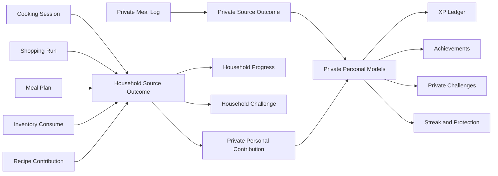

# Requirements Document

## Introduction

Diese Spezifikation definiert Release 1 der synchronisierten Gamification für erwachsene Accounts und Haushalte. Sie verbindet sechs Source Outcomes mit privaten und haushaltsgebundenen Fortschrittsmodellen.

Fünf Source Outcomes gehören einem Household. Ein gespeichertes Meal Log gehört ausschließlich dem erwachsenen Account.

Release 1 umfasst persönliche XP, persönliche Achievements und private Challenges. Er umfasst außerdem Household Challenges und bestehende Streak-Funktionen.

Current Streak, Best Streak, Protection Balance und Protected Days bleiben persönlich. Der Legacy Streak bleibt nur eine private Startmarke.

Household Progress zeigt Wochenaggregate ohne sichtbare Mitgliedzuordnung. Completion Feedback bleibt eine lokale sichtbare oder haptische Rückmeldung je Installation.

Gamification nutzt nur ausdrücklich abgeschlossene fachliche Vorgänge. App-Öffnungen und bloße UI-Aktionen erzeugen keinen Fortschritt.

Persönliche Teilnahme gilt accountweit. Household Participation gilt getrennt je Account und Household.

Alle synchronisierten Daten erhalten vollständige Local-first-Parität als Zielvoraussetzung. Die heutige App erfüllt diese Voraussetzung noch nicht vollständig.

Diese Phase ändert nur den Produktvertrag. Sie ändert keinen Produktcode, kein Datenbankschema und keine Laufzeitdaten.

## Glossary

- **Gamification System**: Der Bereich für Teilnahme, Source Outcomes, Projektionen, Synchronisation, Feedback und Legacy-Übernahme.
- **Account**: Ein authentifizierter erwachsener Nutzer mit stabiler Account-ID.
- **Household**: Die geteilte Entität für berechtigte Household Members.
- **Household Member**: Ein Account mit aktiver Mitgliedschaft und Rolle `admin` oder `member`.
- **Active Household**: Der Household des aktuellen fachlichen Vorgangs oder der geöffneten Household-Sicht.
- **Data Owner**: Die Entität, welche Sichtbarkeit, Lebenszyklus und Löschgrenze eines Datensatzes bestimmt.
- **Personal Participation**: Der serverbestätigte accountweite Zustand `enabled` oder `disabled` mit eigener Revision und Operation ID.
- **Household Participation**: Der serverbestätigte Zustand `enabled` oder `disabled` eines Accounts für genau einen Household mit eigener Revision und Operation ID.
- **Participation Revision**: Die serverautoritativ vergebene, streng steigende Revision für einen Personal- oder Household-Participation-Schlüssel.
- **Participation Operation ID**: Der clientseitig erzeugte stabile Idempotenzschlüssel einer Enable-, Disable- oder Re-enable-Operation.
- **Participation Effective At**: Der serverautoritativ vergebene Zeitpunkt, ab dem eine bestätigte Participation-Revision gilt.
- **Participation Interval**: Der bestätigte Zeitraum zwischen einem wirksamen Enable und dem folgenden wirksamen Disable desselben Participation-Schlüssels.
- **Source Domain**: Der fachliche Owner eines Vorgangs, seiner Berechtigung und seines Gegenwegs.
- **Source Outcome**: Der dauerhaft belegte Abschluss genau eines qualifizierenden Vorgangs.
- **Household Source Outcome**: Ein Source Outcome mit `scope_type = household` und dem Household als Owner.
- **Private Source Outcome**: Ein Source Outcome mit `scope_type = account` und dem Account als Owner.
- **Source Completion Evidence**: Der dauerhaft gespeicherte Nachweis des Source Domain für ein Source Outcome.
- **Source Completion ID**: Die stabile Identität eines Source Outcome. Der jeweilige Source-Vertrag bestimmt ihre clientseitige oder serverautoritative Vergabe.
- **Source Type**: Eine der sechs erlaubten Arten aus der Scope-Matrix.
- **Scope Type**: Der Wert `household` oder `account` für den Owner-Bereich eines Source Outcome.
- **Scope ID**: Die stabile Household-ID oder Account-ID passend zum Scope Type.
- **Occurred At**: Der fachliche Abschlusszeitpunkt als UTC-Zeitstempel.
- **Domain Day**: Der fachliche Kalendertag des Outcome in seiner wirksamen IANA-Zeitzone.
- **Source State**: Der Zustand `active` oder `reversed` eines logischen Source Outcome.
- **Source Revision**: Die serverseitig bestätigte, streng steigende Revision eines logischen Source Outcome.
- **Operation ID**: Der stabile Idempotenzschlüssel einer Source- oder Participation-Operation.
- **Logical Source Key**: Die Eindeutigkeit `(scope_type, scope_id, source_type, source_completion_id)`.
- **Reversal**: Eine Operation, die dasselbe Source Outcome von `active` auf `reversed` setzt.
- **Restoration**: Eine Operation, die dasselbe Source Outcome von `reversed` auf `active` setzt.
- **Retry**: Die Wiederholung derselben Operation mit unveränderter Operation ID.
- **Personal Contribution Record**: Der private Account-Datensatz für einen eigenen Household Source Outcome.
- **Private Meal Log**: Eine ausdrücklich gespeicherte Mahlzeit mit eigener Meal-Log-ID und mindestens einer Position.
- **Meal-Log-ID**: Die stabile Source Completion ID eines ganzen Private Meal Log.
- **Meal Plan Completion ID**: Die serverautoritativ gespeicherte Source Completion ID für genau einen Household, Meal Plan und dessen Household Week.
- **Household Outcome Event**: Der minimierte Household-Datensatz eines Household Source Outcome.
- **Personal XP Ledger**: Das private, abgeleitete Ledger aller persönlichen XP-Vergaben.
- **XP Grant**: Eine versionierte Vergabe für genau ein aktives eigenes Source Outcome.
- **Achievement Definition**: Eine systemverwaltete, versionierte Regel für einen persönlichen Achievement State.
- **Achievement State**: Der private Zustand `locked` oder `unlocked` einer Achievement Definition.
- **Private Challenge**: Eine account-eigene Challenge aus eigenen privaten Outcomes oder Personal Contributions.
- **Household Challenge**: Eine Household-eigene Challenge ausschließlich aus Household Outcome Events.
- **Challenge Instance**: Die unveränderlich versionierte Ausführung einer Challenge Definition.
- **Frozen Challenge Snapshot**: Der unveränderliche Zustand und Fortschritt einer verlassenen, abgebrochenen oder abgelaufenen Challenge Instance. Dazu zählen `left`, `cancelled`, `expired` und jede Instance nach ihrem Endzeitpunkt.
- **Household Progress**: Wochenaggregate aktiver Household Outcome Events ohne sichtbare Mitgliedzuordnung.
- **Account Time Zone**: Die versionierte IANA-Zeitzone für persönliche Tage und private Challenges.
- **Household Time Zone**: Die versionierte IANA-Zeitzone für Household-Tage und Household Challenges.
- **Personal Active Day**: Ein Account-Tag mit mindestens einem aktiven eigenen qualifizierenden Outcome.
- **Current Streak**: Die Anzahl aktiver Tage der laufenden persönlichen Folge.
- **Best Streak**: Die höchste gültige Anzahl aktiver Tage einer persönlichen Folge.
- **Missed Day**: Ein abgelaufener Tag innerhalb persönlicher Teilnahme ohne Personal Active Day.
- **Protected Day**: Ein Missed Day, den eine verfügbare Protection schützt.
- **Protection Balance**: Die verfügbaren Protected Days eines Accounts im Kalendermonat seiner Account Time Zone.
- **Installation ID**: Die stabile lokale Identität einer App-Installation für gerätebezogene Feedback-Einmaligkeit.
- **Completion Feedback**: Eine lokale sichtbare oder haptische Bestätigung. Sie erscheint je `(account_id, installation_id, logical_source_key)` höchstens einmal.
- **Legacy Streak**: Der gerätelokale MMKV-Datensatz `srf:cook-streak`.
- **Legacy Streak Snapshot**: Eine private Startmarke mit bestätigtem `count`, `best` und `lastDate`. Sie kann eine Folge fortsetzen, erzeugt aber keinen Personal Active Day.
- **Migration Decision**: Die einmalige Account-Entscheidung `import` oder `restart` für den Legacy Streak.
- **Personal Progress Reset**: Die ausdrückliche Löschung accountweiter persönlicher Gamification-Daten.
- **Local Gamification Store**: Der account-isolierte SQLite-Spiegel aller synchronisierten Gamification-Daten.
- **Outbox**: Der lokale Puffer für noch nicht bestätigte Mutationen.
- **Reconciliation**: Der deterministische Abgleich von Source Evidence, Operationen, Teilnahme und Projektionen.
- **Realtime Invalidation**: Ein Hinweis auf Remote-Änderungen, der einen Pull anstößt oder lokale Queries invalidiert.
- **RLS**: Row Level Security begrenzt Zugriffe auf Datenbankzeilen.

## Release Scope

### Qualifizierende Source Outcomes

| Bereich | `source_type` | Source Completion ID | Owner |
| --- | --- | --- | --- |
| Household | `cooking_session_completed` | Cooking Session ID | Household |
| Household | `shopping_run_completed` | Shopping Run ID | Household |
| Household | `meal_plan_completed` | serverautoritative Meal Plan Completion ID | Household |
| Household | `inventory_consumed` | Consume Operation ID | Household |
| Household | `recipe_contributed` | Recipe Publication ID | Household |
| Account | `private_meal_log_saved` | Meal-Log-ID | Account |

### Fortschrittsmodelle

- Persönliche XP.
- Persönliche Achievements.
- Private Challenges.
- Household Challenges.
- Persönlicher Current Streak und Best Streak.
- Persönliche Protection Balance und Protected Days.
- Private Legacy Streak Startmarke.
- Household Progress als Wochenaggregate ohne sichtbare Mitgliedzuordnung.
- Completion Feedback als lokale sichtbare oder haptische Rückmeldung je Installation.

### Ausgeschlossene Quellen und Modelle

- Gewichtseinträge.
- Workouts.
- Fastenfenster.
- Medikamente, Symptome, Vitalwerte und Wassertracking.
- Kind-Tracking und alle Einträge mit `child_profile_id`.
- App-Öffnungen, Screen Views, Navigation und Taps.
- Ranglisten und Vergleiche zwischen Accounts.
- Kategorie-Level und allgemeine Level.
- Monetäre Belohnungen.
- Household Achievements.
- Neue Benachrichtigungskampagnen.
- Rückwirkende Rekonstruktion aus alten Historien, Dashboard-Zuständen oder dem Legacy Streak.

## Requirements

### Requirement 1: Einheitlicher Source-Outcome-Vertrag

**User Story:** Als Account möchte ich eindeutige Outcomes, damit Retries und mehrere Geräte nie doppelt zählen.

#### Acceptance Criteria

1. THE Gamification System SHALL persist `scope_type`, `scope_id`, `source_type`, `source_completion_id`, `occurred_at`, `domain_day`, `state`, and `source_revision` for every Source Outcome.
2. THE Gamification System SHALL persist one `operation_id` for every completion, Reversal, and Restoration operation.
3. THE Gamification System SHALL enforce uniqueness by `(scope_type, scope_id, source_type, source_completion_id)`.
4. THE Source Domain SHALL establish `source_completion_id` by the specific Source contract before accepting its first completion.
5. THE client SHALL generate `operation_id` before its first local operation attempt.
6. WHEN a client retries an operation, THE client SHALL reuse the same `operation_id` and payload.
7. WHEN the server receives a repeated `operation_id`, THE server SHALL return the previously accepted result without a second state change.
8. THE server SHALL assign the authoritative Source Revision after serializing accepted operations for one Logical Source Key.
9. WHEN operations arrive out of order, THE Gamification System SHALL apply the greatest server-confirmed Source Revision.
10. THE Gamification System SHALL treat this revision rule as the Source Outcome form of Last-Write-Wins.
11. THE Gamification System SHALL preserve one logical event identifier across completion, Reversal, Restoration, Retry, and synchronization.
12. WHEN a truly new fachlicher Vorgang occurs, THE Source Domain SHALL create a new Source Completion ID.
13. WHEN an existing fachlicher Vorgang is edited, retried, reversed, or restored, THE Source Domain SHALL retain its Source Completion ID.
14. THE Gamification System SHALL reject unsupported `source_type` values from every projection.
15. THE Gamification System SHALL reject Source Evidence that conflicts with Scope Type, Scope ID, or Source Completion ID.
16. WHEN a provisional local outcome is rejected, THE Gamification System SHALL remove its progress during Reconciliation.
17. WHEN Gamification rejects an outcome, THE Source Domain SHALL preserve its completed fachlicher result.
18. THE Gamification System SHALL persist one current server-confirmed state, Participation Revision, Participation Operation ID, and Participation Effective At for each Personal Participation key.
19. THE Gamification System SHALL persist the same fields independently for each Household Participation key.
20. THE client SHALL generate and reuse one Participation Operation ID for every Enable, Disable, or Re-enable attempt and its Retries.
21. THE server SHALL serialize accepted Participation operations per Participation key and assign each a strictly greater Participation Revision and authoritative Participation Effective At.

### Requirement 2: Source-Vertrag für Cooking Sessions

**User Story:** Als Household Member möchte ich einen echten Kochabschluss zählen, nicht das Öffnen eines Rezepts.

#### Acceptance Criteria

1. THE Source Domain SHALL assign one client-generated Cooking Session ID when a Cooking Session starts.
2. THE Source Outcome SHALL use `scope_type = household` and the active Household ID as `scope_id`.
3. THE Source Outcome SHALL use `source_type = cooking_session_completed`.
4. THE Source Outcome SHALL use the Cooking Session ID as `source_completion_id`.
5. THE Source Outcome SHALL use the explicit completion time as `occurred_at`.
6. THE Source Outcome SHALL use the Household Day at `occurred_at` as `domain_day`.
7. WHEN the user explicitly completes the final cooking step, THE Source Domain SHALL activate the Source Outcome.
8. THE Source Domain SHALL store Source Evidence before projecting Gamification progress.
9. THE Source Domain SHALL classify opening, remounting, step changes, and returning from background as non-completions.
10. THE Source Domain SHALL classify entering the finished screen without durable completion evidence as a non-completion.
11. WHEN the Cooking Session is reopened, THE Source Domain SHALL reverse the same Source Outcome.
12. WHEN the reopened Cooking Session is completed again, THE Source Domain SHALL restore the same Source Outcome.
13. WHEN the same completion retries, THE Source Domain SHALL retain the Cooking Session ID and completion Operation ID.
14. WHEN two devices submit the same completion, THE Logical Source Key SHALL retain one Source Outcome.
15. WHEN the same Recipe is cooked later, THE Source Domain SHALL create a new Cooking Session ID.
16. THE current React state and Recipe-ID ref SHALL NOT count as durable Source Evidence.
17. A persistent Cooking Session model and counteraction are planned prerequisites because the current code lacks both.

### Requirement 3: Source-Vertrag für Shopping Runs

**User Story:** Als Household Member möchte ich nur einen erfolgreichen Transfer in den Bestand zählen.

#### Acceptance Criteria

1. THE Source Domain SHALL generate one Shopping Run ID before the first atomic transfer attempt.
2. THE Source Outcome SHALL use `scope_type = household` and the Household ID as `scope_id`.
3. THE Source Outcome SHALL use `source_type = shopping_run_completed`.
4. THE Source Outcome SHALL use the Shopping Run ID as `source_completion_id`.
5. THE Source Outcome SHALL use the successful atomic commit time as `occurred_at`.
6. THE Source Outcome SHALL use the Household Day at `occurred_at` as `domain_day`.
7. WHEN one atomic run creates at least one Inventory Item, THE Source Domain SHALL activate the Source Outcome.
8. THE Source Domain SHALL persist the Shopping Run ID across every transfer leg and Source Evidence record.
9. THE Source Domain SHALL classify checking items, opening the sheet, and cancelling as non-completions.
10. THE Source Domain SHALL classify empty runs and failed or rolled-back transfers as non-completions.
11. WHEN a completed run needs fachliche correction, THE Source Domain SHALL reverse the same Source Outcome.
12. WHEN the corrected transfer becomes valid again, THE Source Domain SHALL restore the same Source Outcome.
13. WHEN the run retries after a lost response, THE Source Domain SHALL reuse its Shopping Run ID and Operation ID.
14. WHEN several devices retry the same run, THE Logical Source Key SHALL retain one Source Outcome.
15. WHEN a later shopping session transfers items, THE Source Domain SHALL create a new Shopping Run ID.
16. THE Gamification System SHALL NOT reconstruct Shopping Runs from item-level `shopping_history` rows.
17. A durable run identity and run-level counteraction are planned prerequisites because the current path lacks both.

### Requirement 4: Source-Vertrag für Meal-Plan-Abschlüsse

**User Story:** Als Household Member möchte ich einen bewusst abgeschlossenen Wochenplan zählen.

#### Acceptance Criteria

1. BEFORE accepting the first completion, THE server SHALL create and persist exactly one authoritative Meal Plan Completion ID on the Meal Plan for its Household Week.
2. THE Source Outcome SHALL use `scope_type = household` and the Household ID as `scope_id`.
3. THE Source Outcome SHALL use `source_type = meal_plan_completed`.
4. THE Source Outcome SHALL use that server-authoritative Meal Plan Completion ID as `source_completion_id`.
5. THE Source Outcome SHALL use the explicit completion time as `occurred_at`.
6. THE Source Outcome SHALL use the Household Day at `occurred_at` as `domain_day`.
7. WHEN a member explicitly completes a plan with one active entry, THE Source Domain SHALL activate the Source Outcome.
8. THE server SHALL enforce one Meal Plan Completion ID and one Logical Source Key for `(household_id, meal_plan_id, household_week)`.
9. THE Source Domain SHALL classify empty plans, entry edits, entry saves, copying, and week expiry as non-completions.
10. THE Source Domain SHALL require Reopen before modifying a completed plan.
11. WHEN a completed plan is reopened, THE Source Domain SHALL reverse the same Source Outcome.
12. WHEN the reopened plan is completed again, THE Source Domain SHALL restore the same Source Outcome.
13. WHEN completion retries, THE client SHALL reuse its Operation ID and THE server SHALL return the persisted Completion ID.
14. WHEN two devices complete the same plan, each client MAY use its own Operation ID, but THE server SHALL serialize both attempts by `(household_id, meal_plan_id, household_week)` and return the same Logical Source Key and outcome.
15. THE Source Domain SHALL NOT create a second Completion ID or Source Outcome for the same Meal Plan and Household Week.
16. A server-authoritative completion state, Completion ID, explicit action, Reopen action, and uniqueness constraint are planned prerequisites.
17. Current `meal_plan_entry.create.completed` telemetry SHALL NOT serve as Source Evidence.

### Requirement 5: Source-Vertrag für Bestandsverbrauch

**User Story:** Als Household Member möchte ich nur ausdrücklichen Verbrauch zählen, nicht Löschung oder Korrektur.

#### Acceptance Criteria

1. THE Source Domain SHALL create one stable Consume Operation ID before changing inventory quantity.
2. THE Source Outcome SHALL use `scope_type = household` and the Household ID as `scope_id`.
3. THE Source Outcome SHALL use `source_type = inventory_consumed`.
4. THE Source Outcome SHALL use the Consume Operation ID as `source_completion_id`.
5. THE Source Outcome SHALL use the committed consume time as `occurred_at`.
6. THE Source Outcome SHALL use the Household Day at `occurred_at` as `domain_day`.
7. WHEN a persisted negative quantity operation has fachlicher reason `consume`, THE Source Domain SHALL activate the Source Outcome.
8. THE Source Domain SHALL require a positive consumed amount and a successful inventory commit.
9. THE Source Domain SHALL classify delete, waste, move, open, inbound stock, and manual correction as non-completions.
10. THE Source Domain SHALL classify negative deltas without reason `consume` as non-completions.
11. WHEN a consume transaction is counterbooked, THE Source Domain SHALL reverse the same Source Outcome.
12. WHEN that exact consume is redone, THE Source Domain SHALL restore the same Source Outcome.
13. WHEN a later real consume occurs, THE Source Domain SHALL create a new Consume Operation ID.
14. WHEN consume retries, THE Source Domain SHALL reuse the Consume Operation ID and Operation ID.
15. WHEN several devices submit the same consume, THE Logical Source Key SHALL retain one Source Outcome.
16. THE Source Domain SHALL prevent Consume, Undo, and Restore from producing two active rewards.
17. A persisted `consume` reason and explicit Redo distinction are planned prerequisites.
18. Current generic `out` transactions SHALL NOT serve as sufficient Source Evidence.

### Requirement 6: Source-Vertrag für Rezeptbeiträge

**User Story:** Als Household Member möchte ich nur einen vollständigen und bewusst gespeicherten Rezeptbeitrag zählen.

#### Acceptance Criteria

1. THE Source Domain SHALL generate one Recipe Publication ID before the first final save attempt.
2. THE Source Outcome SHALL use `scope_type = household` and the Household ID as `scope_id`.
3. THE Source Outcome SHALL use `source_type = recipe_contributed`.
4. THE Source Outcome SHALL use the Recipe Publication ID as `source_completion_id`.
5. THE Source Outcome SHALL use the successful final-save time as `occurred_at`.
6. THE Source Outcome SHALL use the Household Day at `occurred_at` as `domain_day`.
7. A complete contribution SHALL contain a title, one active component, one valid active item, and one active preparation step.
8. WHEN the author explicitly saves all required parts successfully, THE Source Domain SHALL activate the Source Outcome.
9. THE Source Domain SHALL classify a root row, draft, partial failure, preview, and ordinary edit as non-completions.
10. THE Source Domain SHALL classify an unchanged Recipe Template copy as a non-completion.
11. WHEN imported content receives explicit review and a complete final save, THE Source Domain MAY classify it as a contribution.
12. WHEN the contribution is deleted or withdrawn, THE Source Domain SHALL reverse the same Source Outcome.
13. WHEN that contribution is restored or republished, THE Source Domain SHALL restore the same Source Outcome.
14. WHEN final save retries, THE Source Domain SHALL reuse Publication ID and Operation ID.
15. WHEN several devices submit the same publication, THE Logical Source Key SHALL retain one Source Outcome.
16. A later edit SHALL NOT create a new Source Outcome.
17. A later distinct Recipe SHALL use a new Recipe Publication ID.
18. Atomic completion evidence, Publication ID, withdrawal, and restore are planned prerequisites.
19. The current root-first multi-mutation save SHALL NOT serve alone as complete Source Evidence.

### Requirement 7: Source-Vertrag für private Meal Logs

**User Story:** Als erwachsener Account möchte ich eine ganze gespeicherte Mahlzeit zählen, nicht jede Food-Position.

#### Acceptance Criteria

1. THE Source Domain SHALL generate one client-side Meal-Log-ID before the first local save.
2. THE Source Outcome SHALL use `scope_type = account` and the Account ID as `scope_id`.
3. THE Source Outcome SHALL use `source_type = private_meal_log_saved`.
4. THE Source Outcome SHALL use the Meal-Log-ID as `source_completion_id`.
5. THE Source Outcome SHALL use the explicit whole-log save time as `occurred_at`.
6. THE Source Outcome SHALL use the Account Day at `occurred_at` as `domain_day`.
7. WHEN an adult Account saves a complete Meal Log with one active position, THE Source Domain SHALL activate one Source Outcome.
8. THE Meal Log and every included Food Entry SHALL have `child_profile_id = null`.
9. THE Source Domain SHALL group all positions of one meal under the same Meal-Log-ID.
10. THE Source Domain SHALL classify adding, editing, or retrying a Food Entry as no additional Source Outcome.
11. THE Source Domain SHALL classify drafts, empty logs, and failed whole-log saves as non-completions.
12. THE Source Domain SHALL classify every record with `child_profile_id` as a non-completion.
13. WHEN the Meal Log is deleted, THE Source Domain SHALL reverse the same Source Outcome.
14. WHEN the Meal Log is restored, THE Source Domain SHALL restore the same Source Outcome.
15. WHEN save retries, THE Source Domain SHALL reuse the Meal-Log-ID and Operation ID.
16. WHEN several devices submit the same Meal Log, THE Logical Source Key SHALL retain one Source Outcome.
17. A later distinct meal SHALL receive a new Meal-Log-ID.
18. Editing an existing Meal Log SHALL retain its Source Completion ID and SHALL NOT award again.
19. Private Meal Logs SHALL remain accountwide and SHALL contain no Household ID.
20. Private Meal Logs MAY increase personal XP, Achievements, Private Challenges, and Personal Active Days.
21. Private Meal Logs SHALL NOT increase Household Progress or Household Challenges.
22. A Meal Log aggregate, client IDs, SQLite mirror, Outbox, Pull, and conflict handling are planned prerequisites.
23. The current direct Supabase Food Entry API SHALL NOT be described as offline-capable.

### Requirement 8: Teilnahme, Opt-in und Opt-out

**User Story:** Als Account möchte ich persönliche und haushaltsgebundene Teilnahme getrennt steuern.

#### Acceptance Criteria

1. THE Gamification System SHALL initialize Personal Participation as `disabled` for every Account.
2. THE Gamification System SHALL initialize Household Participation as `disabled` for every Account and Household pair.
3. WHEN Personal Participation Enable is server-confirmed, THE Gamification System SHALL start one accountwide confirmed Participation Interval at its Participation Effective At.
4. WHEN Household Participation Enable is server-confirmed, THE Gamification System SHALL start one confirmed interval for that Account and Household at its Participation Effective At.
5. THE setup SHALL explain sources, owners, visibility, retention, reset, streak, protection, and Legacy behavior before Opt-in.
6. Personal Participation SHALL control private Meal Log outcomes, XP, Achievements, Private Challenges, and personal streak projections.
7. Household Participation SHALL control new Household Outcomes from that Account in that Household.
8. WHEN both participations are active, THE Gamification System SHALL create private Personal Contributions for own Household Outcomes.
9. Personal XP and Achievements MAY combine own Personal Contributions from several Households.
10. A Household switch SHALL NOT move or re-own accountwide personal data.
11. WHILE Personal Participation is disabled, THE Gamification System SHALL collect no new private Source Outcomes or Personal Contributions.
12. WHILE Household Participation is disabled, THE Gamification System SHALL collect no new Household Outcomes from that Account and Household.
13. WHEN Personal Participation is disabled, THE Gamification System SHALL hide personal Gamification views but retain prior data until reset.
14. WHEN Personal Participation is disabled, THE Gamification System SHALL end Current Streak without consuming Protected Days.
15. WHEN Personal Participation is enabled again, THE Gamification System SHALL start Current Streak at zero.
16. WHEN Personal Participation is enabled again without reset, THE Gamification System SHALL preserve Best Streak and prior private progress.
17. WHEN Personal Participation is disabled, THE Gamification System SHALL move active Private Challenges to `left`.
18. WHEN Household Participation is disabled, THE Gamification System SHALL hide Household Progress and Household Challenges from that Account.
19. WHEN Household Participation is disabled, THE Gamification System SHALL retain accepted Household Outcomes as Household history.
20. A Household Opt-out SHALL NOT change private Meal Log outcomes or accountwide personal data.
21. A Personal Opt-out SHALL NOT change Household membership or Household role.
22. Participation SHALL remain independent from analytics, notifications, premium, and Household role.
23. Every Opt-out SHALL become locally durable with its Participation Operation ID before its Outbox operation is queued.
24. Personal Participation operations SHALL be serialized by the server for their Account key, independent of client timestamps or arrival device.
25. Household Participation operations SHALL be serialized separately for each `(account_id, household_id)` key.
26. WHEN concurrent offline Enable, Disable, or Re-enable operations reach the server, THE greatest accepted Participation Revision SHALL define the current state.
27. Each accepted Participation Revision SHALL open or close its confirmed interval at the server-assigned Participation Effective At.
28. Reconciliation SHALL use only server-confirmed Participation Revisions, intervals, and effective times for Source Outcomes and projections.
29. An offline Opt-out SHALL stop later local collection provisionally, but server confirmation and revision order SHALL determine the converged interval on every device.
30. Re-enable SHALL create a new confirmed interval only when its accepted Participation Revision follows the effective Disable revision.

### Requirement 9: Persönliches XP-Ledger

**User Story:** Als Account möchte ich nachvollziehbare XP aus gültigen eigenen Outcomes erhalten.

#### Acceptance Criteria

1. THE Account SHALL own the Personal XP Ledger.
2. THE XP Ledger SHALL remain private across every Household role.
3. Each XP Grant SHALL reference exactly one active Private Source Outcome or active Personal Contribution.
4. Each XP Grant SHALL store `rule_id`, `rule_version`, the awarded integer value, and its source reference.
5. Release 1 SHALL use `rule_id = source-outcome-xp` and `rule_version = 1`.
6. Rule version 1 SHALL award exactly 10 XP for each of the six allowed Source Types.
7. THE rule active at `occurred_at` SHALL determine a new XP Grant.
8. THE Gamification System SHALL create at most one Grant per Account, source reference, rule ID, and rule version.
9. WHEN a Source Outcome becomes reversed, THE Gamification System SHALL neutralize the same XP Grant.
10. WHEN that Source Outcome is restored, THE Gamification System SHALL reactivate the same XP Grant.
11. Restoration SHALL NOT create a second XP Grant.
12. WHEN a later rule version becomes active, THE Gamification System SHALL preserve historical Grant values and versions.
13. THE visible XP balance SHALL equal the sum of active Grants.
14. THE visible XP balance MAY decrease after a valid Reversal.
15. Achievement unlocks SHALL award zero additional XP in Release 1.
16. Challenge completion SHALL award zero additional XP in Release 1.
17. App-Öffnungen and unsupported sources SHALL award zero XP.
18. Clients SHALL NOT insert, update, neutralize, or reactivate XP Grants directly.

### Requirement 10: Persönliche Achievements

**User Story:** Als Account möchte ich private Achievements mit klaren und prüfbaren Schwellen erhalten.

#### Acceptance Criteria

1. THE Account SHALL own every Achievement State.
2. Achievement Definitions SHALL be system-owned and immutable by normal clients.
3. Each Achievement Definition SHALL store stable Definition ID, Definition Version, threshold, unit, and allowed Source Types.
4. Release 1 SHALL include Definition `first-outcome`, version 1, threshold 1, unit `active_outcomes`.
5. `first-outcome` SHALL allow all six Source Types.
6. Release 1 SHALL include Definition `household-helper-10`, version 1, threshold 10, unit `active_personal_contributions`.
7. `household-helper-10` SHALL allow the five Household Source Types only.
8. Release 1 SHALL include Definition `meal-logger-7`, version 1, threshold 7, unit `active_meal_logs`.
9. `meal-logger-7` SHALL allow only `private_meal_log_saved`.
10. THE Gamification System SHALL count logical active outcomes, not transport operations or Food Entry rows.
11. WHEN a threshold is met, THE Gamification System SHALL set the matching Achievement State to `unlocked`.
12. WHEN Reversal lowers progress below threshold, THE Gamification System SHALL set that State to `locked`.
13. WHEN Restoration meets the threshold again, THE Gamification System SHALL reactivate the same State.
14. Restoration SHALL NOT create a second Achievement State.
15. THE Gamification System SHALL permit at most one local unlock feedback per Definition ID and Definition Version.
16. Re-unlock after Reversal SHALL NOT repeat unlock feedback.
17. Later Definition Versions SHALL NOT rewrite historical State evaluations for closed versions.
18. Household Members and admins SHALL NOT read another Account's Achievement States.
19. Household Achievements SHALL remain outside Release 1.
20. Clients SHALL NOT write Achievement States directly.

### Requirement 11: Private Challenges

**User Story:** Als Account möchte ich private Challenges nur aus meinen eigenen Daten verfolgen.

#### Acceptance Criteria

1. THE Account SHALL own every Private Challenge Instance and its progress.
2. A Private Challenge Definition SHALL store stable ID, version, allowed sources, target, unit, start, end, and timezone basis.
3. A new Instance SHALL copy its Definition Version and rules without later mutation.
4. Private Challenges SHALL use the Account Time Zone effective at their start.
5. Private Challenges MAY use own Private Meal Log outcomes and own Personal Contributions.
6. Private Challenges SHALL NOT use another Account's events or Household aggregate activity.
7. A Private Challenge SHALL start in `available`.
8. WHEN the Account opts in to an available challenge, THE Instance SHALL enter `active`.
9. WHEN active progress reaches target, THE Instance SHALL enter `completed`.
10. WHEN the Account leaves an active or completed challenge, THE Instance SHALL enter terminal state `left` with its current progress as a Frozen Challenge Snapshot.
11. WHEN an incomplete active challenge reaches its end, THE Instance SHALL enter terminal state `expired` with its current progress as a Frozen Challenge Snapshot.
12. Opt-in SHALL NOT import qualifying outcomes from before the Instance start.
13. Progress SHALL count active allowed outcomes whose `occurred_at` lies within `[start, end)`.
14. Before the Instance end, Reversal SHALL update progress only for an `active` or `completed` Instance and MAY return `completed` to `active`.
15. At the Instance end, an incomplete `active` Instance SHALL become `expired`, while a `completed` Instance SHALL retain `completed`; both SHALL freeze their state and progress.
16. Before the Instance end, Restoration SHALL update only an `active` or `completed` Instance, restore the same contribution without duplication, and MAY reactivate completion.
17. After the Instance end, Restoration or Reversal MAY update its Source Outcome and personal projections but SHALL NOT change Challenge state or progress.
18. A `left` or `expired` Instance SHALL remain terminal and frozen under every later Reversal, Restoration, Opt-in, or sync order.
19. Personal Opt-out SHALL move active Private Challenges to `left`.
20. Personal re-enable SHALL NOT reactivate a left Challenge automatically.
21. Personal Progress Reset SHALL delete Private Challenge Instances and progress.
22. WHEN the Account resets one active or completed Private Challenge before its end, THE old Instance SHALL enter `left` and remain a Frozen Challenge Snapshot.
23. A specific Private Challenge reset SHALL create a new `available` Instance with a new ID and zero progress.
24. The new Instance SHALL exclude outcomes before its new start time.
25. Completing a Private Challenge SHALL award no XP in Release 1.
26. Clients MAY start, leave, or reset their own Instance but SHALL NOT write progress counters directly.
27. WHEN a Frozen Challenge Snapshot is reset, THE old Instance SHALL remain unchanged and THE reset SHALL create only the new Instance from criterion 23.

### Requirement 12: Household Challenges

**User Story:** Als Household Member möchte ich gemeinsame Ziele ohne individuelle Beiträge oder Ranglisten sehen.

#### Acceptance Criteria

1. THE Household SHALL own every Household Challenge Instance and its progress.
2. A Household Challenge Definition SHALL store stable ID, version, allowed sources, target, unit, start, end, and timezone basis.
3. A new Instance SHALL copy its Definition Version and rules without later mutation.
4. Household Challenges SHALL use the Household Time Zone effective at Instance start.
5. Household Challenges SHALL allow only the five Household Source Types.
6. Household Challenges SHALL never use Private Meal Logs, Private Source Outcomes, XP, or Achievement States.
7. Household Challenge progress SHALL contain no visible Account IDs, names, contributions, or placements.
8. A Household Challenge SHALL start in `available`.
9. WHEN a Household admin activates an available challenge, THE Instance SHALL enter `active`.
10. WHEN active progress reaches target, THE Instance SHALL enter `completed`.
11. WHEN a Household admin ends an active or completed challenge, THE Instance SHALL enter terminal state `cancelled` with its current progress as a Frozen Challenge Snapshot.
12. WHEN an incomplete active challenge reaches its end, THE Instance SHALL enter terminal state `expired` with its current progress as a Frozen Challenge Snapshot.
13. Progress SHALL count active allowed Household Outcomes whose `occurred_at` lies within `[start, end)`.
14. Before the Instance end, Reversal SHALL update progress only for an `active` or `completed` Instance and MAY return `completed` to `active`.
15. At the Instance end, an incomplete `active` Instance SHALL become `expired`, while a `completed` Instance SHALL retain `completed`; both SHALL freeze their state and progress.
16. Before the Instance end, Restoration SHALL update only an `active` or `completed` Instance, restore the same contribution without duplication, and MAY reactivate completion.
17. After the Instance end, Restoration or Reversal MAY update its Household Source Outcome and personal projections but SHALL NOT change Household Challenge state or progress.
18. A `cancelled` or `expired` Instance SHALL remain terminal and frozen under every later Reversal, Restoration, activation, or sync order.
19. Household Participation SHALL act as the member Opt-in for viewing and future contribution.
20. Household Opt-out SHALL stop future Outcomes from that Account but SHALL retain prior aggregate progress.
21. WHEN a Household admin resets an active or completed Challenge before its end, THE old Instance SHALL enter `cancelled` and remain a Frozen Challenge Snapshot.
22. A Household Challenge reset SHALL create a new `available` Instance with a new ID and zero progress.
23. The new Instance SHALL exclude Outcomes before its new start time.
24. Loss of membership SHALL remove access immediately after authoritative membership refresh.
25. Completing a Household Challenge SHALL award no XP in Release 1.
26. Only Household admins MAY activate, cancel, or reset a Household Challenge.
27. Clients SHALL NOT write Household Challenge progress counters directly.
28. WHEN a Frozen Challenge Snapshot is reset, THE old Instance SHALL remain unchanged and THE reset SHALL create only the new Instance from criterion 22.

### Requirement 13: Household Progress ohne sichtbare Mitgliedzuordnung

**User Story:** Als Household Member möchte ich gemeinsame Wochenwerte sehen, ohne persönliche Profile offenzulegen.

#### Acceptance Criteria

1. THE Household SHALL own Household Outcome Events and Household Progress.
2. Household Progress SHALL use the current Monday-to-Monday Household Week.
3. Household Progress SHALL show one count for each of the five Household Source Types.
4. Household Progress SHALL show the number of distinct active Household Days.
5. Multiple active Outcomes on one Household Day SHALL count as one active Household Day.
6. Reversed Outcomes SHALL contribute zero to Household Progress.
7. Restored Outcomes SHALL contribute once to Household Progress.
8. Household Progress SHALL expose no contributor names, Account IDs, per-member counts, ranks, streaks, XP, or private challenge data.
9. Household Progress SHALL expose no Recipe titles, item names, quantities, Meal Log details, or Tracking Data.
10. Current members with enabled Household Participation MAY read Household Progress.
11. Opted-out Accounts SHALL lose the Household Progress view but SHALL retain the settings entry.
12. Membership loss SHALL remove Household Progress access for the former Household.
13. Accepted Household Outcomes SHALL survive contributor Opt-out or membership loss.
14. The product SHALL describe these aggregates as lacking visible member attribution, not as fully anonymous.

### Requirement 14: Persönliche Streaks und Protected Days

**User Story:** Als Account möchte ich eine Tagesfolge aus eigenen gültigen Outcomes erhalten.

#### Acceptance Criteria

1. Current Streak, Best Streak, Protection Balance, and Protected Days SHALL belong to the Account.
2. The personal streak SHALL remain accountwide across Households.
3. The personal streak SHALL use the Account Time Zone effective at each `occurred_at`.
4. Each of the six Source Types MAY create a Personal Active Day.
5. A Household Source Outcome SHALL create personal activity only through an active own Personal Contribution.
6. A Private Meal Log SHALL create personal activity only through an active own Private Source Outcome.
7. Multiple allowed Outcomes on one Account Day SHALL create exactly one Personal Active Day.
8. New Source Types SHALL NOT create a second contribution for an already active Account Day.
9. The first Personal Active Day in an interval SHALL set Current Streak to one unless a valid Legacy continuity rule in criteria 28 through 33 applies.
10. A directly following Personal Active Day SHALL increase Current Streak by one.
11. The current unfinished Account Day SHALL NOT count as a Missed Day.
12. An unprotected, fully elapsed Missed Day SHALL break Current Streak.
13. A later Personal Active Day SHALL start Current Streak at one.
14. Best Streak SHALL equal the greatest sequence supported by current active outcomes, protections, and Legacy Snapshot.
15. Reversal SHALL recalculate Personal Active Days, Current Streak, Best Streak, and Protected Days.
16. Reversal SHALL preserve a day when another active Outcome remains on that day.
17. Restoration SHALL reactivate the same day contribution without creating another day.
18. THE Gamification System SHALL allocate two Protected Days per Account Time Zone calendar month.
19. Protection Balance SHALL never exceed two.
20. Unused Protected Days SHALL expire at month end without rollover.
21. THE system SHALL protect at most two consecutive Missed Days.
22. Protected Days SHALL preserve a sequence but SHALL NOT increase Current Streak or Best Streak.
23. Protected Days SHALL NOT increase XP, Achievements, Challenges, or Household Progress.
24. Reconciliation SHALL recalculate protection chronologically under the original monthly limits.
25. Personal Opt-out SHALL end Current Streak and consume no protection outside participation.
26. Personal re-enable SHALL start Current Streak at zero and preserve Best Streak unless reset occurred.
27. Personal Progress Reset SHALL set Current Streak, Best Streak, and Protection Balance history to zero or empty.
28. A confirmed Legacy Streak Snapshot with positive Current Streak and `lastDate` equal to the current or previous Account Day at import SHALL act as a continuity anchor.
29. A qualifying Outcome on the imported `lastDate` SHALL preserve the Legacy Current Streak and SHALL NOT increase it again.
30. The first later Personal Active Day SHALL increase the Legacy Current Streak by one when no unprotected Missed Day after imported `lastDate` has broken the sequence.
31. Reconciliation SHALL evaluate only fully elapsed days strictly after imported `lastDate` for Protection, and SHALL consume Protection only for days inside confirmed Personal Participation.
32. WHEN an unavailable Protection leaves such a day unprotected, THE next Personal Active Day SHALL start Current Streak at one.
33. A missing, invalid, or older Legacy continuity anchor SHALL leave Current Streak at zero until the first Personal Active Day sets it to one.

### Requirement 15: Legacy Streak Startmarke

**User Story:** Als bestehender Account möchte ich einen plausiblen Legacy Streak bewusst privat übernehmen.

#### Acceptance Criteria

1. THE Gamification System SHALL validate `count` and `best` as non-negative integers.
2. THE Gamification System SHALL validate `lastDate` as a calendar date or `null`.
3. A positive `count` with `lastDate = null` SHALL be invalid.
4. A `count` greater than `best` SHALL be invalid.
5. A future `lastDate` relative to Account Day SHALL be invalid.
6. THE Gamification System SHALL never infer Account or Household ownership automatically.
7. THE first Personal Participation setup SHALL require one Migration Decision for the Account.
8. A valid Legacy Streak SHALL offer `import` and `restart`.
9. A missing or invalid Legacy Streak SHALL require `restart`.
10. `import` SHALL require explicit confirmation that the local data belongs to the signed-in Account.
11. Confirmed import SHALL create one private Legacy Streak Snapshot containing validated `count`, `best`, and `lastDate`.
12. The Snapshot SHALL preserve Legacy `best` as the initial Best Streak floor.
13. A positive Legacy `count` with `lastDate` equal to the current or previous Account Day at import SHALL preserve that count as the Current Streak continuity anchor.
14. An older `lastDate`, zero `count`, or unavailable valid anchor SHALL initialize Current Streak to zero.
15. `restart` SHALL initialize Current Streak and Best Streak to zero.
16. The Snapshot SHALL create no Personal Active Day, Source Outcome, XP Grant, Achievement, Challenge progress, or Household Progress.
17. A qualifying Outcome on imported `lastDate` SHALL NOT increase imported Current Streak.
18. The first later Personal Active Day SHALL increase imported Current Streak by one only while chronological Protection leaves every elapsed day after `lastDate` unbroken.
19. THE Gamification System SHALL persist at most one Migration Decision per Account.
20. Later devices SHALL ignore local Legacy Streaks after receiving that Migration Decision.
21. Acknowledged migration SHALL delete `srf:cook-streak` from the supplying device.
22. Failed synchronization SHALL retain the local Legacy Streak until acknowledgement or successful restart.
23. Runtime SHALL stop Legacy reads and writes after locally durable Migration Decision, except pending cleanup.
24. Personal Progress Reset SHALL delete the Snapshot but retain the Migration Decision.
25. THE Gamification System SHALL never reconstruct historical Source Outcomes from the Legacy Streak.

### Requirement 16: Completion Feedback

**User Story:** Als Account möchte ich eine ruhige Bestätigung für einen dauerhaft gespeicherten Abschluss erhalten.

#### Acceptance Criteria

1. THE Gamification System MAY show visible or haptic Completion Feedback after first local durability for one Account, Installation ID, and Logical Source Key.
2. Feedback SHALL occur at most once per `(account_id, installation_id, logical_source_key)`.
3. Duplicate Outbox entries, Restore operations, Realtime invalidations, Pull rows, and Retries SHALL NOT repeat Feedback on the same Installation.
4. A different Installation MAY show its own Feedback once for the same Account and Logical Source Key.
5. Release 1 SHALL NOT require globally accountwide Feedback uniqueness while devices are offline.
6. Achievement re-unlock after Reversal SHALL NOT repeat unlock Feedback on the same Installation.
7. Feedback failure SHALL NOT roll back or block the Source Domain completion.
8. Release 1 SHALL create no notification campaign for Gamification.
9. Release 1 SHALL NOT require confetti or a specific visual animation.

### Requirement 17: RLS, Datenbesitz und direkte Schreibgrenzen

**User Story:** Als Account möchte ich private Daten privat und Household-Daten haushaltsgebunden halten.

#### Acceptance Criteria

1. System rule and challenge definitions SHALL be readable as required and writable only by a controlled server path.
2. Household Source Evidence SHALL be owned by the Household and readable only by validation paths.
3. Household Outcome Events SHALL be owned by the Household.
4. Private Source Outcomes, Personal Contributions, XP, Achievements, Private Challenges, streaks, and Legacy data SHALL be Account-owned.
5. RLS SHALL limit Account-owned rows to `auth.uid() = owner_account_id`.
6. Household admins SHALL receive no access to another Account's private Gamification data.
7. RLS SHALL limit Household Progress and Household Challenges to current members with required participation.
8. Direct client writes to XP Grants, Achievement States, and all Challenge progress SHALL be denied.
9. Direct client writes to Source Revisions and derived streak or protection values SHALL be denied.
10. Source Outcome state changes SHALL pass Source Evidence, ownership, membership, participation, and operation validation.
11. Household roles SHALL NOT broaden private data access.
12. Raw Source Completion IDs SHALL NOT appear in member-visible aggregate views.
13. Clients SHALL receive only minimized fields required for their authorized projections.

### Requirement 18: Membership, Löschung, Reset und Export

**User Story:** Als Account möchte ich verständliche Lebenszyklen für meine persönlichen und geteilten Daten.

#### Acceptance Criteria

1. Membership loss SHALL reject new Household Outcomes for the former Account and Household.
2. Membership loss SHALL remove access to Household Progress and Household Challenges.
3. Membership loss SHALL retain accepted Household Outcomes without a visible contributor relationship.
4. Membership loss SHALL retain the former Account's private XP, Achievements, Contributions, and Private Challenges.
5. Household deletion SHALL delete Household Source Evidence, Household Outcomes, Household Challenges, and aggregate progress.
6. Household deletion SHALL reverse linked Personal Contributions before deleting their Household links.
7. Household deletion SHALL neutralize XP Grants whose only active source was a deleted Personal Contribution.
8. Household deletion SHALL recalculate affected Achievements, streaks, protections, and only mutable Private Challenges before their end; Frozen Challenge Snapshots SHALL remain unchanged.
9. Account deletion SHALL delete Personal Participation and all Account-owned Gamification data.
10. Account deletion SHALL remove private contributor links before profile deletion.
11. Account deletion SHALL retain accepted Household Outcomes as Household-owned records.
12. Account deletion SHALL leave no visible Gamification relationship to the deleted Account.
13. Personal Progress Reset SHALL disable Personal Participation accountwide.
14. Personal Progress Reset SHALL delete private Source Outcomes, Contributions, XP, Achievements, Private Challenges, streaks, protections, and Legacy Snapshot.
15. Personal Progress Reset SHALL retain the completed Migration Decision without Legacy values.
16. Personal Progress Reset SHALL NOT delete Household Outcomes or Household Challenge progress.
17. Re-enable after reset SHALL start Current Streak and Best Streak at zero.
18. Personal export SHALL include Personal Participation, private Source Outcomes, own Contributions, XP Ledger, Achievement States, and Private Challenge Instances.
19. Personal export SHALL include streaks, protections, Opt-out state, Reset state, Legacy Snapshot, and Migration Decision.
20. Personal export SHALL exclude private data of other Accounts and Household Source Evidence.
21. Household-owned aggregates MAY use a separate Household export authorized by existing Household rules.
22. Current data export code requires planned extension because it contains no Gamification data.

### Requirement 19: Local-first- und Sync-Parität

**User Story:** Als Account möchte ich gültige Outcomes offline speichern und nach Sync auf allen Geräten denselben Stand sehen.

#### Acceptance Criteria

1. Every synchronized Gamification entity SHALL have a declarative backend schema and explicit RLS.
2. Every synchronized Gamification entity SHALL have a local SQLite mirror and generated local migration.
3. Every synchronized Gamification entity SHALL appear in the Entity union and sync metadata.
4. Every local mutation SHALL use a stable client-generated Operation ID and SHALL enter the Outbox atomically with its local mirror write.
5. Push SHALL validate and apply operations idempotently by Operation ID.
6. Pull SHALL use a durable cursor and SHALL retrieve authoritative rows for Account and Household scopes.
7. Reconciliation SHALL compare Source Evidence, operations, server-confirmed Participation Revisions, confirmed intervals, their Participation Effective At values, and derived projections.
8. Realtime SHALL only accelerate invalidation and SHALL NOT determine correctness.
9. Pull and Reconciliation SHALL guarantee eventual convergence after successful sync cycles.
10. Private Meal Logs SHALL receive complete SQLite, stable-ID, Outbox, Push, Pull, and conflict parity before release.
11. Cooking Sessions, Shopping Runs, Meal Plan completions, Consume reasons, and Recipe publications SHALL receive durable Source Evidence before release.
12. XP, Achievements, Challenge Instances, Challenge progress inputs, streaks, protections, and Participation states, revisions, Operation IDs, and effective times SHALL have local mirrors.
13. While offline, locally valid operations MAY create provisional progress from locally available membership, provisional participation, and timezone data.
14. The UI SHALL distinguish provisional progress until server confirmation.
15. Reconciliation SHALL admit Source Outcomes and projections only through server-confirmed Participation Intervals and their effective times.
16. A rejected remote operation SHALL remove unsupported provisional progress after Pull and Reconciliation.
17. A rejected Gamification operation SHALL NOT undo the Source Domain result.
18. Duplicate Outbox entries SHALL converge to one logical operation.
19. Multiple devices SHALL converge by Logical Source Key and greatest server-confirmed Source Revision.
20. Account switching SHALL close the prior account database before opening the next account database.
21. Sign-out SHALL stop sync, guard unsynced Outbox work, and remove locally readable prior-account Gamification data.
22. Household membership refresh SHALL remove locally readable Household views after membership loss.
23. Query invalidation SHALL cover every changed Gamification projection after Push, Pull, and Realtime hints.
24. Personal data SHALL use Account-scoped sync channels or pulls and SHALL never enter Household channels.
25. Household data SHALL use Household-scoped sync and membership filters.
26. Current Realtime coverage lacks Meal Plans, Recipes, and Gamification tables and is a planned implementation gap.
27. Current Entity metadata lacks Food Entries, Meal Logs, and Gamification entities and is a planned implementation gap.
28. The current direct Food Entry API SHALL NOT be presented as Local-first.
29. Multiple devices SHALL converge to the greatest server-confirmed Participation Revision for each Personal or Household Participation key.
30. THE Local Gamification Store SHALL persist a feedback marker keyed by `(account_id, installation_id, logical_source_key)` before showing Completion Feedback.
31. Restore, Realtime, Pull, Retry, and Outbox replay SHALL consult that local marker and SHALL NOT repeat Feedback on the same Installation.
32. Feedback markers SHALL remain installation-local and SHALL NOT require accountwide sync.

### Requirement 20: Zeit, Konflikte und Reconciliation

**User Story:** Als Account möchte ich stabile Tage und deterministische Ergebnisse trotz Offline-Nutzung erhalten.

#### Acceptance Criteria

1. Personal setup SHALL require a valid Account Time Zone before Personal Participation starts.
2. Household setup SHALL require a valid Household Time Zone before first Household Participation starts.
3. Timezone configuration SHALL store IANA identifier, effective time, and revision.
4. Existing Domain Days SHALL remain stable after a later timezone change.
5. New Outcomes SHALL use the timezone version effective at `occurred_at`.
6. Offline clients SHALL use the latest locally stored applicable timezone version provisionally.
7. Pull SHALL correct unconfirmed Domain Days from authoritative timezone history when required.
8. Backdated Outcomes SHALL count by `occurred_at` only when Source Evidence permits that timestamp.
9. Future Domain Days SHALL remain excluded until their day starts or a correction replaces the timestamp.
10. Two concurrent operations for one Logical Source Key SHALL be serialized by the server.
11. A valid later server operation SHALL receive a greater Source Revision.
12. Pull SHALL replace lower provisional revisions with the authoritative revision.
13. Reversal arriving before completion data SHALL converge after both records are available.
14. Restoration arriving before a stale Reversal copy SHALL remain active when its Source Revision is greater.
15. Rule Definitions and Challenge Instance rules SHALL never use Last-Write-Wins mutation after Instance creation.
16. Reconciliation SHALL be repeatable and SHALL create no additional Grant, Unlock, day, or progress contribution.
17. A Successful Sync Cycle SHALL push due Outbox work and then pull authoritative state.
18. All devices SHALL show equal projections after receiving the same authoritative state and completing Reconciliation.
19. THE server SHALL serialize Participation operations independently per Personal Participation or Household Participation key.
20. A greater server-confirmed Participation Revision SHALL win regardless of client timestamp, arrival device, or local provisional order.
21. Reconciliation SHALL ignore unconfirmed Participation intervals when creating or retaining Source Outcomes and projections.
22. Reconciliation SHALL NOT recalculate state or progress of a Frozen Challenge Snapshot.
23. Reconciliation after the Instance end MAY update Source and personal projections but SHALL retain the frozen Challenge result.

### Requirement 21: Ausschlüsse und Missbrauchsgrenzen

**User Story:** Als Account möchte ich Fortschritt nur aus den ausdrücklich erlaubten Ergebnissen erhalten.

#### Acceptance Criteria

1. Weight Entries SHALL create no XP, Achievement, Streak, Challenge, or Household progress.
2. Workouts SHALL create no XP, Achievement, Streak, Challenge, or Household progress.
3. Fasting windows SHALL create no XP, Achievement, Streak, Challenge, or Household progress.
4. Child Profile data SHALL create no Gamification projection.
5. An adult saving data for a Child Profile SHALL create no Gamification projection.
6. App launches SHALL create no XP, Achievement, Streak, Challenge, or other Gamification projection.
7. Navigation, Screen Views, Taps, and local UI state SHALL create no Gamification projection.
8. Recipe edits SHALL NOT farm additional Recipe Contribution rewards.
9. Food Entry rows SHALL NOT farm additional Meal Log rewards.
10. Consume, Undo, and Restore SHALL retain one logical reward source.
11. Reopen and re-complete SHALL retain one logical reward source.
12. Delete and Restore SHALL retain one logical reward source.
13. Cooking followed by a distinct Private Meal Log MAY create two Source Outcomes.
14. The two Outcomes in criterion 13 SHALL use different Source Types and Source Completion IDs.
15. Meal Plan completion SHALL NOT re-count its included recipes or later cooking actions.
16. Category Levels, general Levels, leaderboards, monetary rewards, and Household Achievements SHALL remain excluded.
17. Release 1 SHALL create no new Gamification notification campaign.
18. Historical Source Outcomes SHALL NOT be reconstructed from `shopping_history`, dashboards, old cooking state, or Legacy Streak.
19. Only Source Outcomes after the applicable Opt-in effective time SHALL qualify.

### Requirement 22: Fehlergrenzen und Implementierungsstatus

**User Story:** Als Account möchte ich fachliche Kernaktionen auch bei Gamification-Fehlern zuverlässig abschließen.

#### Acceptance Criteria

1. Source Domain completion SHALL remain independent from feedback, XP, Achievement, Challenge, and streak failures.
2. A Gamification write failure SHALL preserve the Source Domain result and its recoverable Source Evidence.
3. Reconciliation SHALL create a missing logical Outcome exactly once from valid Source Evidence inside a server-confirmed Participation Interval.
4. Reconciliation SHALL NOT import evidence outside confirmed Participation Effective At boundaries or historical evidence.
5. Unreadable Gamification storage SHALL show Gamification as unavailable without changing Source Domain data.
6. Invalid synchronized data SHALL remain excluded from every projection.
7. No criterion in this document SHALL claim that planned schema or runtime support already exists.
8. Before implementation, the project SHALL add backend schemas, RLS, pgTAP tests, SQLite schemas, sync handlers, and focused product tests.
9. Before implementation, each visible action SHALL receive its specified counteraction.
10. The Requirements phase SHALL modify no product code, database schema, migration, test, or runtime data.

## Repository Evidence and Planned Prerequisites

### Verified current behavior

- `src/features/gamification/streak.ts` stores only `count`, `lastDate`, and `best` in MMKV.
- `src/features/recipes/screens/cooking-mode-screen.tsx` uses React state and a Recipe-ID ref for completion.
- `src/features/shopping-list/hooks/use-complete-shopping-run.ts` transfers items atomically but creates no run-level ID.
- `supabase/schemas/14_meal_plans.sql` contains no completion state or completion timestamp.
- `src/features/meal-planner/use-meal-plans.ts` has no explicit plan-completion action.
- `supabase/schemas/08_inventory.sql` distinguishes `in`, `out`, `waste`, and `open` only.
- The inventory schema lacks fachlicher reason `consume` for normal negative quantity operations.
- `src/features/inventory/inventory-screen.tsx` sends the same quantity path for consume and delete.
- `src/features/recipes/screens/recipe-create-screen.tsx` saves the root before all child records finish.
- `src/features/recipes/hooks/use-recipes.ts` provides soft-delete but no complete contribution restore flow.
- `supabase/schemas/09_tracking.sql` stores one row per Food Entry and has no Meal-Log-ID.
- `src/features/calorie-tracking/api.ts` writes Food Entries directly to Supabase.
- `src/lib/db/schemas/tracking.ts` contains no Food Entry or Meal Log mirror.
- `src/lib/db/types.ts` and `src/lib/db/entities.ts` contain no Food Entry, Meal Log, or Gamification entities.
- `src/lib/sync/realtime.ts` subscribes to five Household tables only.
- `supabase/schemas/90_realtime.sql` publishes no Meal Plan, Recipe, Meal Log, or Gamification table.
- `src/features/settings/data-export.ts` exports no Gamification data.
- `supabase/schemas/` contains no dedicated Gamification schema.

### Required implementation surfaces

- Declarative Supabase schemas and privileges.
- Explicit RLS policies and pgTAP tests.
- Local Drizzle schemas and generated SQLite migrations.
- Stabile Source Completion IDs gemäß Source-Vertrag und clientseitige Operation IDs für jede Mutation.
- Entity union and sync metadata.
- Outbox enqueue and idempotent Push.
- Account- and Household-scoped Pull cursors.
- Realtime invalidation where suitable.
- Deterministic Reconciliation.
- Query invalidation for all projections.
- Account switch and Sign-out cleanup.
- Membership refresh and Household deletion handling.
- Personal export and Account deletion handling.
- Focused tests for completion, Reversal, Restoration, Retry, multiple devices, and exclusions.

## Scope Boundaries

- Release 1 umfasst genau sechs Source Types.
- Fünf Source Types sind Household Source Outcomes.
- `private_meal_log_saved` ist das einzige private Source Outcome.
- Private Meal Logs gehören accountweit dem erwachsenen Account.
- Private Meal Logs enthalten keine Household-ID und kein `child_profile_id`.
- Persönliche XP, Achievements und Private Challenges bleiben accountweit privat.
- Household Outcomes, Household Progress und Household Challenges bleiben haushaltsgebunden.
- Household Challenges verwenden nur die fünf Household Source Types.
- Household Progress zeigt Wochenaggregate ohne sichtbare Mitgliedzuordnung.
- Current Streak, Best Streak, Protection Balance und Protected Days bleiben persönlich und accountweit.
- Der Legacy Streak bleibt eine private Startmarke ohne rekonstruierte Outcomes.
- Completion Feedback bleibt lokal, sichtbar oder haptisch und erscheint je Account, Installation und Logical Source Key höchstens einmal.
- Meal-Plan-Abschlüsse verwenden genau eine serverautoritative Completion ID je Household, Meal Plan und Household Week.
- Personal Participation und Household Participation konvergieren getrennt über serverbestätigte Revisionen, Operation IDs und wirksame Zeiten.
- `left`, `cancelled`, `expired` und alle Challenge-Instanzen nach ihrem Endzeitpunkt bleiben eingefrorene historische Snapshots.
- Ein bestätigter Legacy Snapshot kann die erste spätere persönliche Aktivität ohne Legacy Source Outcome fortsetzen.
- Gewicht, Workouts, Fastenfenster und Kind-Tracking bleiben ausgeschlossen.
- App-Öffnungen und bloße UI-Aktionen bleiben für alle Projektionen ausgeschlossen.
- Ranglisten, Kategorie-Level, allgemeine Level und monetäre Belohnungen bleiben ausgeschlossen.
- Household Achievements und neue Benachrichtigungskampagnen bleiben ausgeschlossen.
- Alte Historien, Dashboard-Zustände und Legacy-Daten erzeugen keine rückwirkenden Source Outcomes.
- Vollständige Local-first-Parität ist eine Release-Voraussetzung, kein heutiges Ist-Versprechen.
- Diese Phase ändert keine Implementierung, kein Schema, keine Migration und keine Tests.
