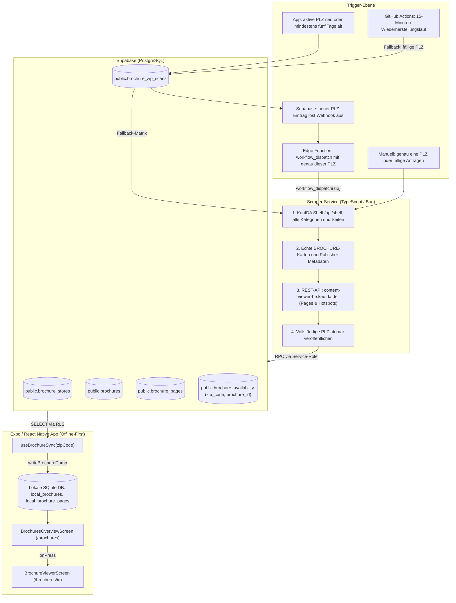

# Prospekte-Architektur & Production-Ready Pipeline

## 1. Übersicht & Zielsetzung

Die Prospekte-Funktion stellt für jede deutsche Postleitzahl (PLZ) aktuelle KaufDA-Prospekte aus allen verfügbaren Kategorien bereit. Dazu gehören Lebensmittelhändler, Drogerien, Elektronik, Möbel und weitere von KaufDA für den Standort gelistete Publisher. Prospekte enthalten nach Möglichkeit interaktive Hotspots mit Bounding-Boxen, Preisen und Rabatten.

### Zentrale Anforderungen
- **Umfassende Abdeckung:** Alle echten Prospekte, die KaufDA für die jeweilige PLZ in allen Kategorien anbietet.
- **Vollständige Interaktivität:** Jeder Prospekt enthält relative Koordinaten ($x, y, w, h$ in Prozent) für Angebote, Produkttitel, Beschreibungen, Streichpreise, Rabatte und Originalpreise in Cent.
- **Speicher:** Keine Bildbytes in Supabase oder R2. Crawler-Aufrufe entstehen nur für angefragte PLZ.
- **Geschwindigkeit & Effizienz:** Kein ressourcenintensiver Headless-Browser in Produktion; direkte HTTP-Abfragen. Die Dauer für alle Kategorien wird im PLZ-Pilot gemessen.
- **Offline-Verhalten:** Prospektdaten und Hotspots werden in SQLite gespiegelt. Bilder bleiben CDN-URLs; offline sind sie verfügbar, wenn `expo-image` sie noch im Cache hat.

---

## 2. API-Erkenntnisse & Technische Entdeckung

Durch Analyse der Netzwerkkommunikation von KaufDA / Bonial konnte der Datenabruf vollständig auf native REST-Endpunkte umgestellt werden.

### 2.1 Schritt 1: Geocoding (PLZ $\to$ Koordinaten)
Für eine angefragte 5-stellige PLZ werden Breitengrad (`lat`), Längengrad (`lng`) und Ortsname aus der lokalen GeoNames-PLZ-Datei bestimmt. Der Runner liest diese Datei lokal und ruft KaufDA nur für die ausgewählte PLZ auf. Er iteriert nicht über alle PLZ.
- Beispiel PLZ `22043`: `lat: 53.5659`, `lng: 10.0254`, Ort: `Hamburg`.

### 2.2 Schritt 2: PLZ-Katalog und Prospekt-Erkennung
KaufDAs regionale Shelf-API liefert die für einen Standort sichtbaren Karten über alle Kategorien. Der Runner ruft sie mit PLZ-Koordinaten und leerem `sectorIds`-Parameter ab und liest die Seitennavigation vollständig:
```http
GET /api/shelf?lat=53.5659&lng=10.0254&size=250&page=0&sectorIds= HTTP/1.1
Host: www.kaufda.de
Cookie: location=%7B%22lat%22%3A53.5659%2C%22lng%22%3A10.0254%2C%22city%22%3A%22Hamburg%22%2C%22zip%22%3A%2222043%22%2C%22countryCode%22%3A%22DE%22%7D
Accept: application/json
User-Agent: Mozilla/5.0 ...
```
Die Antwort enthält `contents[]` und `page` mit Seitennummer, Seitengröße, Gesamtmenge und Gesamtseiten. Die Suche läuft bis zur letzten Seite. Karten mit `content.type === "BROCHURE"` enthalten Publisher, `contentId`, Titel, Gültigkeitszeitraum und Seitenzahl. Dynamische Angebotskarten (`content.type === "DYNAMIC"`) haben keine Viewer-Seiten und werden ausgelassen. Publisher werden aus den Antworten gelesen; es gibt keine feste Händlerliste.

### 2.3 Schritt 3: Hochauflösende Seiten & Hotspots abrufen
Mit der `contentId` wird der interne JSON-Endpunkt aufgerufen:
```http
GET /v1/brochures/${contentId}/pages?partner=kaufda_web&brochureKey=&lat=${lat}&lng=${lng} HTTP/1.1
Host: content-viewer-be.kaufda.de
Referer: https://www.kaufda.de/
bonial-api-consumer: web-content-viewer-fe
User-Agent: Mozilla/5.0 ...
```

**Ergebnis:**
- Vollständiges JSON-Array aller Einzelseiten (`contents[]`).
- Hochauflösende Bild-URLs bis `2800x2800` Pixel auf dem Bonial CDN (`content-media.bonial.biz`).
- Alle Angebote (`offers[]`) mit relativer Bounding-Box (`area.topLeft`, `area.bottomRight`), Produkttitel, Beschreibung, Cent-Preisen und Rabatt-Labels.

---

## 3. End-to-End Systemarchitektur



---

## 4. Datenbankmodell (Supabase)

Das Schema trennt Stammdaten, Prospekt-Kopfdaten, Seiten-Details und regionale Verfügbarkeit sauber ab:

```sql
-- 1. Händler-Stammdaten
create table public.brochure_stores (
  id text primary key,               -- KaufDA publisher ID, z. B. 'kaufda:<publisherId>'
  name text not null,                -- aus der KaufDA-Antwort
  logo_url text,
  active boolean not null default true,
  created_at timestamptz not null default now()
);

-- 2. Prospekte (Kopfdaten)
create table public.brochures (
  id text primary key,               -- Quelle + PLZ + Publisher + contentId
  source_content_id text not null,
  source_zip_code text not null,
  store_id text not null references public.brochure_stores(id) on delete cascade,
  title text not null,
  valid_from timestamptz not null,
  valid_until timestamptz not null,
  cover_image text not null,
  page_count integer not null default 1,
  created_at timestamptz not null default now(),
  updated_at timestamptz not null default now(),
  constraint brochures_validity check (valid_until >= valid_from),
  constraint brochures_id_source_zip_unique unique (id, source_zip_code)
);

create index idx_brochures_store_id on public.brochures(store_id);
create index idx_brochures_valid_until on public.brochures(valid_until);

-- 3. Seiten & Interaktive Hotspots
create table public.brochure_pages (
  id text primary key,               -- '${brochure_id}_${page_number}'
  brochure_id text not null references public.brochures(id) on delete cascade,
  page_number integer not null,
  image_url text not null,
  thumbnail_url text,
  hotspots jsonb not null default '[]'::jsonb,
  created_at timestamptz not null default now(),
  unique (brochure_id, page_number)
);

create index idx_brochure_pages_brochure on public.brochure_pages(brochure_id, page_number);

-- 4. Regionale Verfügbarkeit (PLZ-Zuordnung)
create table public.brochure_availability (
  zip_code text not null,
  brochure_id text not null,
  constraint brochure_availability_regional_fk
    foreign key (brochure_id, zip_code)
    references public.brochures(id, source_zip_code) on delete cascade,
  primary key (zip_code, brochure_id)
);

create index idx_brochure_availability_zip on public.brochure_availability(zip_code);
create index idx_brochure_availability_brochure on public.brochure_availability(brochure_id);

-- 5. Nachfragegesteuerte PLZ-Scans
create table public.brochure_zip_scans (
  zip_code text primary key check (zip_code ~ '^[0-9]{5}$'),
  requested_at timestamptz not null default now(),
  last_successful_at timestamptz,
  next_attempt_at timestamptz not null default now(),
  attempt_count integer not null default 0 check (attempt_count >= 0),
  last_error text,
  updated_at timestamptz not null default now()
);
```

### RLS-Sicherheitsregeln
- `brochure_stores`, `brochures`, `brochure_pages` und `brochure_availability`:
  - `SELECT`: Erlaubt für alle authentifizierten Nutzer (`authenticated`).
  - `INSERT` / `UPDATE` / `DELETE`: Nur über die `service_role` (Scraper-Workflow).
- `brochure_zip_scans` ist für App-Sitzungen gesperrt. Authentifizierte Apps
  verwenden `request_brochure_zip_scan` und `get_brochure_zip_scan_status`; der
  App-Hook stellt dabei nur die aktive PLZ ein. Der Runner erhält fällige PLZ
  über `get_pending_brochure_zip_scans`.

---

## 5. Client-Synchronisation & Offline-First

In der mobilen App bleiben Prospektdaten und Hotspots lokal nutzbar; die
Prospektbilder werden weiter vom Bonial-CDN geladen:

1. **PLZ-Auflösung:** `useBrochurePostalCode` liefert die aktuelle PLZ (per GPS oder manuelle Nutzereingabe).
2. **Bedarf und Synchronisation:** `useBrochureSync(postalCode)` stellt zuerst
   einen Scanwunsch für die aktive PLZ ein. Supabase stellt ihn nur ein, wenn
   es noch keinen erfolgreichen Scan gibt oder dieser mindestens fünf Tage
   zurückliegt. Ein neuer PLZ-Eintrag löst sofort den Datenbank-Webhook und
   einen Runner-Aufruf nur für diese PLZ aus. Danach fragt die App
   `brochure_availability` ab:
   ```ts
   const { data: rows } = await supabase
     .from('brochure_availability')
     .select('zip_code, brochure:brochures!inner(id,source_content_id,source_zip_code,store_id,title,valid_from,valid_until,page_count,cover_image,pages:brochure_pages(id,page_number,image_url,hotspots),store:brochure_stores!inner(id,name,logo_url))')
     .eq('zip_code', postalCode);
   ```
3. **SQLite-Speicherung:** `writeBrochureDump` schreibt die Daten atomar in die lokalen SQLite-Tabellen:
   - `local_brochure_stores`
   - `local_brochures`
   - `local_brochure_pages`
   - `local_brochure_cache` (`zip_code = postalCode`)
4. **UI-Rendering:**
   - **`BrochuresOverviewScreen`:** Filterbare Kachelansicht aller Märkte und Prospekte.
   - **`BrochureViewerScreen`:** Vollbild-Ansicht mit Pager, Hotspot-Markern (`BrochureHotspot`) und Hinzufügen zur Einkaufsliste. Bildbytes werden nicht in die lokale Datenbank kopiert.

---

## 6. Automatisierung via GitHub Actions

Ein neuer oder nach fünf Tagen erneuerter Eintrag in `brochure_zip_scans`
löst nach dem Commit einen asynchronen Supabase-Datenbank-Webhook aus. Er sendet
nur die betroffene PLZ an `dispatch-brochure-scan`. Die Edge Function prüft
das Webhook-Secret und startet `.github/workflows/scrape-brochures.yml` mit
`workflow_dispatch` und genau dieser PLZ. Sie kann keine anderen PLZ aus der
Datenbank auswählen. Ein erneuter App-Aufruf während eines laufenden Scans
ändert den Eintrag nicht und startet keinen zweiten Lauf.
Der Runner sperrt Läufe je PLZ: Ein Scan für eine andere PLZ muss nicht hinter
einem langen laufenden Scan warten.

Gleichzeitige App-Anfragen derselben PLZ laufen über den eindeutigen
`zip_code`-Eintrag zusammen und erzeugen keinen zweiten offenen Scan. Anfragen
verschiedener PLZ haben eigene Einträge und Runner-Jobs. Auch die atomare
Veröffentlichung ist je PLZ gesperrt; dadurch können parallele Scans weder die
Anfrage noch Prospektdaten einer anderen PLZ überschreiben. Unterschiedliche
PLZ können parallel laufen, abhängig von der verfügbaren GitHub-Runner-Kapazität.

Der 15-Minuten-Workflow bleibt als Wiederherstellungsweg aktiv, falls der
asynchrone Webhook oder der GitHub-Aufruf ausfällt. Sein leichter Prüfjob fragt
nur fällige, bereits von der App angefragte PLZ ab; bei leerer Warteschlange
startet kein Scraper-Job und KaufDA wird nicht aufgerufen. Ein manueller Lauf
kann eine einzelne PLZ direkt prüfen.

Für die sofortige Auslösung benötigt Supabase das serverseitige Secret
`GITHUB_WORKFLOW_DISPATCH_TOKEN` mit Schreibrecht für GitHub-Actions-Workflows
im Repository `goldjunge91/fam`. Die Datenbank liest die Function-URL und das
eigene Webhook-Secret aus Supabase Vault; dasselbe Webhook-Secret wird als
`BROCHURE_DISPATCH_WEBHOOK_SECRET` in den Edge-Function-Secrets hinterlegt.
Keines dieser Secrets liegt in der Expo-App oder im Git.

Für jede PLZ ruft der Runner den KaufDA-Shelf mit deren Koordinaten ab. Er
paginiert alle Kategorien und lädt die Viewer-Seiten echter Prospekte
(`content.type === BROCHURE`). Dynamische Angebotskarten ohne Prospektseiten
werden übersprungen. Publisher werden anhand der KaufDA-Antwort angelegt oder
aktualisiert. Ein Fehler bei der Pagination oder einem Prospekt verhindert den
Austausch der gesamten PLZ und lässt deren letzten veröffentlichten Bestand
bestehen. Die App zeigt den zuletzt veröffentlichten Bestand für ihre aktive
PLZ und stellt bei Bedarf im Hintergrund einen Scanwunsch ein. Eine PLZ erhält
eigene Prospektzeilen und Seiten; dieselbe KaufDA-contentId führt nicht dazu,
dass eine PLZ die gespeicherten Seiten einer anderen PLZ nutzt.

Supabase-Schlüssel werden nur auf `main` eingebunden. Der Workflow hat nur
`contents: read`; der separate Workflow-Dispatch-Token wird ausschließlich
von der serverseitigen Supabase Edge Function verwendet. Es werden keine Seitenbilder heruntergeladen oder
Bilddateien als Actions-Artefakte gespeichert. Es gibt keinen Deutschlandlauf
über alle PLZ. Die Zahl der KaufDA-Abfragen folgt den aktiven App-Anfragen und
dem fünf Tage langen Frischefenster.

---

## 7. Verifikations- und Qualitätsmatrix

| Kriterium | Status | Beleg |
| :--- | :--- | :--- |
| **Hotspot-Präzision** | Teilweise geprüft | Koordinaten werden auf den Seitenbereich begrenzt und als Prozentwerte normalisiert; die visuelle Ausrichtung wird im Pilot geprüft. |
| **Abrufumfang** | Nachfragegesteuert | KaufDA wird nur für eine neue aktive PLZ oder nach fünf Tagen erneut abgefragt. Ein vollständiger Deutschlandlauf findet nicht statt. |
| **Ressourcenverbrauch** | Verifiziert | Kein Playwright/Chromium im Produktionsbetrieb erforderlich; läuft als leichtes Bun/Node-Skript. |
| **Typ- und Testabdeckung** | Lokal verifiziert | TypeScript-Check, Biome, 11 Scraper-Tests, 29 App-Tests, 51 pgTAP-Assertions, lokale Migration und Typgenerierung bestanden. |
| **Sprachregel** | Eingehalten | Untersagter K-Begriff wird weder in Schema, Code, noch Dokumentation verwendet. |
