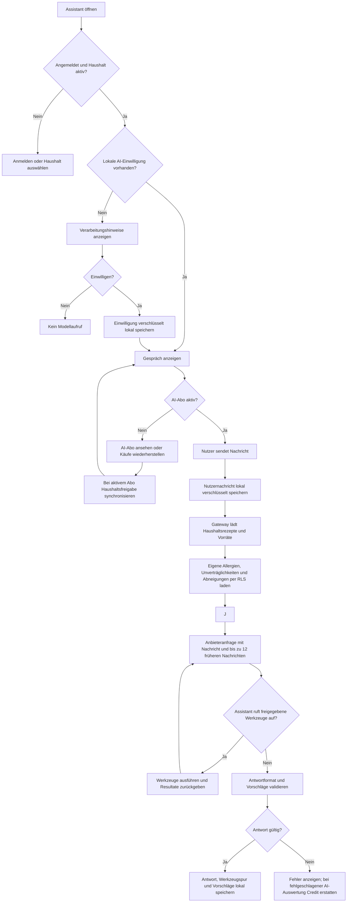
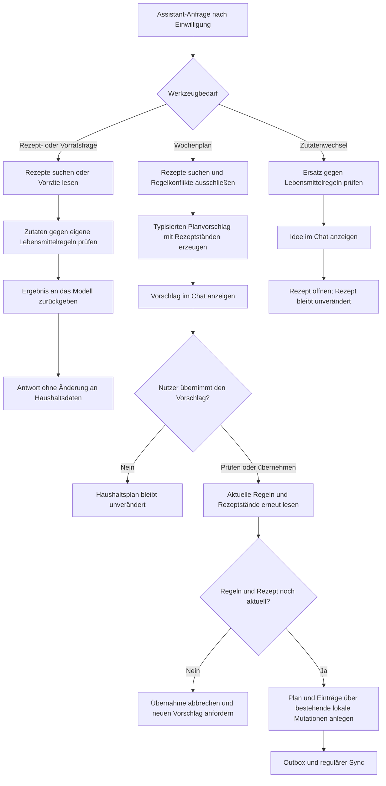
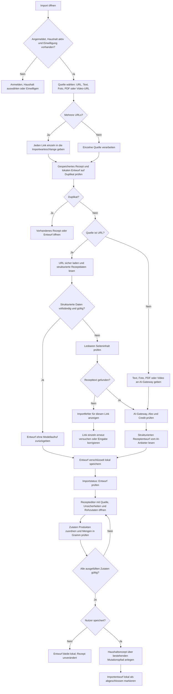
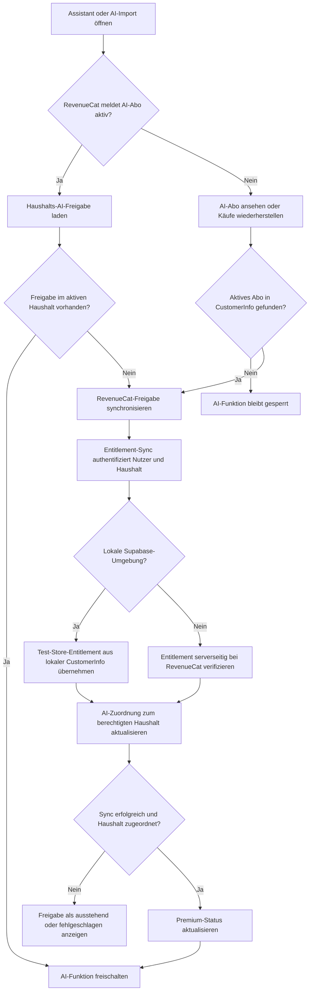
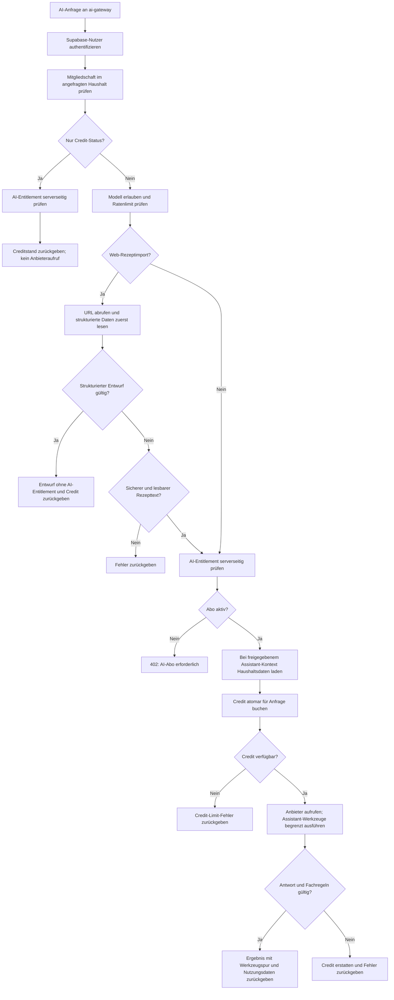

# AI-Abläufe in fam

**Stand:** Lokaler Prototyp im Review-Worktree, 2026-11-08
**Zweck:** Die Diagramme beschreiben den aktuellen Ablauf in der App und im lokalen Supabase-Gateway. Sie sind keine Zusage für noch nicht implementierte Funktionen.

## 1. Assistant: Nachricht und Haushaltskontext

Der Modellaufruf verwendet ein serverseitig festgelegtes Modell aus der Allowlist; in der App gibt es keine Modellauswahl für Nutzer und keinen separaten Haushaltskontext-Schalter. Nach der AI-Einwilligung lädt das Gateway für jede Assistant-Anfrage Haushaltsrezepte, Vorräte und die eigenen Lebensmittelregeln des anfragenden Accounts. Die vier Assistant-Werkzeuge sind auf höchstens sechs Modellrunden begrenzt. Gespräche und Einwilligung werden verschlüsselt im Account-Speicher auf dem Gerät gehalten.

## 2. Assistant-Werkzeuge und Vorschläge

`search_recipes` und `get_inventory` lesen nur. Ein Wochenplan wird erst nach ausdrücklicher Nutzeraktion angelegt und vor dem Anwenden erneut auf geänderte Lebensmittelregeln, Haushalt und Rezeptstand geprüft. Ein Zutatenwechsel ist im aktuellen Prototyp eine Idee mit Link zum Rezept; er wird nicht automatisch gespeichert.

## 3. AI-Rezeptimport

Strukturierte Webseitenrezepte benötigen keinen AI-Aufruf. Text-, Foto-, PDF- und Videoauswertung sowie der Fallback für unvollständige Webseiten verwenden das Gateway und dessen Abo-/Credit-Prüfung. Quellinhalte gelten dabei als nicht vertrauenswürdige Daten; die AI-Antwort muss dem strukturierten Entwurfsformat entsprechen. Der Video-Pfad übergibt die öffentliche Video-URL direkt an ein unterstütztes Modell; Untertitel, Audio oder Einzelbilder werden nicht separat extrahiert. Importentwürfe werden erst nach Prüfung und ausdrücklichem Speichern zu Haushaltsrezepten.

## 4. AI-Abo und Haushaltsfreigabe

Die App kann Käufe wiederherstellen; für eine echte AI-Anfrage prüft das Gateway die Haushaltsberechtigung erneut serverseitig. Die Clientmeldung allein ist keine Berechtigung. Die Test-Store-Variante gilt nur für die lokale Supabase-Umgebung.

## 5. AI-Gateway: Berechtigung, Credit und Anbieteraufruf

Providerfehler, leere Antworten und ungültige Modellantworten erstatten den gebuchten Credit. Eine erfolgreiche AI-Auswertung verbraucht ihn. Die strukturierte Rezeptantwort ist die Ausnahme: Sie kehrt vor AI-Entitlement und Credit-Buchung zurück.

## Noch nicht in diesen Abläufen enthalten

- Teilen aus anderen Apps und der konkrete Instagram-Shortcut-Ablauf.
- Extraktion von Untertiteln, Audiospur oder Videoframes.
- Sprachaufnahme und Vorlesen, Belegverarbeitung, Bildgenerierung und externe Rezeptsuche.
- Assistant-Anhänge und serverseitig synchronisierte Gespräche.

Die Produktziele und fachlichen Grenzen stehen in [AI und Assistant](ai-und-assistant-produktziel.md) und [Rezeptimport](rezeptimport-produktziel.md). Die Diagramme beschreiben die Implementierung im Review-Worktree; bei Änderungen am Quellverhalten müssen sie mitaktualisiert werden.
