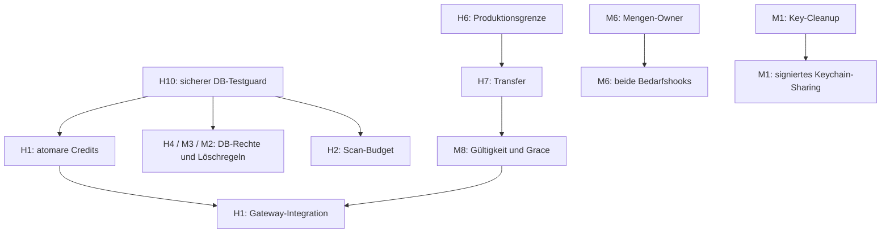

# Audit-Behebung: Übersicht der Einzelpläne

Status: Planung zur Freigabe; die Umsetzung hat noch nicht begonnen.
Stand: 27. Oktober 2026. Ausgangsaudit: `fam-aen4`.
Planaufteilung: `fam-h6op`; ursprüngliche Gesamtplanung: `fam-b0ig`.

**Jedes Problem besitzt einen eigenen Plan und einen eigenen vorhandenen
Bead.** Es gibt 20 Audit-Einzelpläne und zwei ergänzende Pläne für
Edge-Qualität und Dependency-Advisories. Größere Probleme behalten ihre
kleinen Umsetzungs-Beads innerhalb des jeweiligen Einzelplans.

Beads besitzt Status, Akzeptanzkriterien, Dateiscope und Nachweise. Diese
Datei ist die Übersicht. Die fachlichen Entscheidungen stehen im jeweiligen
Einzelplan; gemeinsame Regeln stehen im
[Arbeitsrahmen](/Volumes/Programme/github/family_app/fam/tasks/audit-remediation/workflow.md).
Der bestehende Dashboard-Plan `tasks/plan.md` bleibt unverändert.

## Einzelpläne

| Problem | Eigener Plan | Zuständiger Bead | Phase |
| --- | --- | --- | --- |
| C1 | [Historischen Supabase-Serverkey behandeln](/Volumes/Programme/github/family_app/fam/tasks/audit-remediation/c1-supabase-serverkey/plan.md) | `fam-w1w0` | 0 |
| H10 | [DB-Teststarter ohne automatischen Reset ausführen](/Volumes/Programme/github/family_app/fam/tasks/audit-remediation/h10-db-testguard/plan.md) | `fam-0mww` | 0 |
| H3 | [Privilegierten Batch-Importer absichern](/Volumes/Programme/github/family_app/fam/tasks/audit-remediation/h3-batch-importer/plan.md) | `fam-7iu0.1` | 0 |
| M7 | [Bildproxy gegen Zugriffe auf interne Dienste begrenzen](/Volumes/Programme/github/family_app/fam/tasks/audit-remediation/m7-bildproxy-ssrf/plan.md) | `fam-7iu0.2` | 0 |
| G1 | [Edge-Qualitätsgate reproduzierbar grün herstellen](/Volumes/Programme/github/family_app/fam/tasks/audit-remediation/g1-edge-qualitaetsgate/plan.md) | `fam-z33t.1` | 0 |
| G2 | [Dependency-Advisories nach Erreichbarkeit beheben](/Volumes/Programme/github/family_app/fam/tasks/audit-remediation/g2-dependency-advisories/plan.md) | `fam-z33t.2` | 0, Updates nach Priorität |
| H4 | [Kind-Profil-Löschung nach Haushaltsaustritt sperren](/Volumes/Programme/github/family_app/fam/tasks/audit-remediation/h4-kind-profil-loeschrechte/plan.md) | `fam-qdjx` | 1 |
| M3 | [Demotion des einzigen Haushaltsadmins verhindern](/Volumes/Programme/github/family_app/fam/tasks/audit-remediation/m3-letzter-admin/plan.md) | `fam-1tju` | 1 |
| H1 | [AI-Gateway an Abo und Credits binden](/Volumes/Programme/github/family_app/fam/tasks/audit-remediation/h1-ai-gateway-zugriff/plan.md) | `fam-koxq` | 1 und 2 |
| H2 | [Prospekt-Scan-Dispatch begrenzen](/Volumes/Programme/github/family_app/fam/tasks/audit-remediation/h2-prospekt-scan-budget/plan.md) | `fam-r4ec` | 1 |
| H6 | [Sandbox und Produktionsberechtigungen trennen](/Volumes/Programme/github/family_app/fam/tasks/audit-remediation/h6-revenuecat-sandbox/plan.md) | `fam-fp4t` | 1 |
| H7 | [Kaufübertragungen korrekt abgleichen](/Volumes/Programme/github/family_app/fam/tasks/audit-remediation/h7-revenuecat-transfer/plan.md) | `fam-nl7e.1` | 2 |
| M8 | [Abo-Zugriff bei verlorenen Ablaufereignissen begrenzen](/Volumes/Programme/github/family_app/fam/tasks/audit-remediation/m8-abo-gueltigkeit/plan.md) | `fam-nl7e.2` | 2 |
| H5 | [Browser-OAuth auf PKCE umstellen](/Volumes/Programme/github/family_app/fam/tasks/audit-remediation/h5-oauth-pkce/plan.md) | `fam-521t` | 3 |
| H8 | [Gesamten Einkaufsabschluss atomar speichern](/Volumes/Programme/github/family_app/fam/tasks/audit-remediation/h8-einkaufsabschluss/plan.md) | `fam-o1f1` | 3 |
| H9 | [Offline-Änderungen beim manuellen Logout erhalten](/Volumes/Programme/github/family_app/fam/tasks/audit-remediation/h9-offline-logout/plan.md) | `fam-ncux` | 3 |
| M1 | [SQLCipher-Schlüssel sicher löschen und teilen](/Volumes/Programme/github/family_app/fam/tasks/audit-remediation/m1-sqlcipher-schluessel/plan.md) | `fam-pbd8` | 3 und 5 |
| M2 | [Account-Löschung für Receipt-Autoren ermöglichen](/Volumes/Programme/github/family_app/fam/tasks/audit-remediation/m2-receipt-autoren-loeschen/plan.md) | `fam-i0om` | 3 |
| M4 | [Erwachsenengewicht von Kind-Einträgen trennen](/Volumes/Programme/github/family_app/fam/tasks/audit-remediation/m4-erwachsenen-gewicht/plan.md) | `fam-vyb2` | 4 |
| M5 | [Tatsächliche Feature-Queries nach Sync invalidieren](/Volumes/Programme/github/family_app/fam/tasks/audit-remediation/m5-sync-query-keys/plan.md) | `fam-ninv` | 4 |
| M6 | [Packungsmaße im Einkaufsbedarf berücksichtigen](/Volumes/Programme/github/family_app/fam/tasks/audit-remediation/m6-packungsmengen/plan.md) | `fam-n71d` | 4 |
| L1 | [Session-Fragment auf der Bestätigungsseite entfernen](/Volumes/Programme/github/family_app/fam/tasks/audit-remediation/l1-bestaetigungs-fragment/plan.md) | `fam-9qox` | 4 |

Zusammengefasste ehemalige Sammel-Beads werden nicht dupliziert:
`fam-7iu0.1` besitzt H3, `fam-7iu0.2` besitzt M7;
`fam-nl7e.1` besitzt H7, `fam-nl7e.2` besitzt M8.
Die Eltern `fam-7iu0`, `fam-nl7e` und `fam-z33t` dienen weiter der
Zusammenfassung ihrer getrennten Probleme.

## Empfohlene Reihenfolge

| Phase | Schwerpunkt |
| --- | --- |
| 0 | C1 identifizieren und Betriebsvorgang vorbereiten; H10, H3, M7 und G1 korrigieren; G2 triagieren |
| 1 | H4, M3, atomare Credit-Grundlage aus H1, H2 und H6 |
| 2 | H7 → M8 → Gateway-Integration aus H1 |
| 3 | H5, H8, H9, Schlüssel-Cleanup aus M1 und M2 |
| 4 | M4, M5, M6 und L1 |
| 5 | Native Keychain-Abnahme aus M1, erforderliche einzelne Paketupdates und Abschlussabnahme |

Die Phasen sind Prioritäten. Unabhängige kleine Korrekturen benötigen keinen
künstlichen Abschluss aller vorigen Phasen. Ein tatsächlich erreichbarer
High-/Critical-Dependency-Pfad wird nach Triage vorgezogen.

## Verbindliche Abhängigkeiten

Die zugehörigen Beads-Abhängigkeiten bleiben erhalten. Innerhalb von H1, M1
und M6 erklären die eigenen Pläne die Reihenfolge der Teilaufgaben.

## Kontrollpunkte

| Bead | Abnahme |
| --- | --- |
| `fam-vul8` | sichere lokale Prüfungen und Tool-Grenzen |
| `fam-1e31` | Haushaltsrechte und Kostenbudgets |
| `fam-f98c` | vollständiger Zahlungs- und AI-Zugriffspfad |
| `fam-o9ze` | Account-Wechsel und lokale Datensicherheit |
| `fam-aja5` | alle Audit-Befunde nachgewiesen behoben |

Der Abschluss verlangt Nachweise für alle 20 Befunde sowie die notwendige
Gate-/Dependency-Nacharbeit. Ungeklärte Risiken oder fehlende native/
betriebliche Voraussetzungen bleiben offen. Die Planaufteilung selbst
schließt keinen Fehlerbehebungs-Bead.
