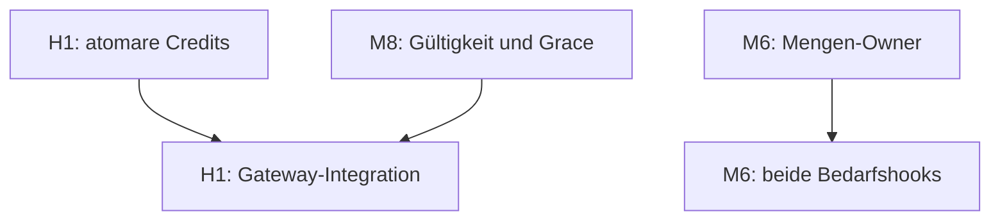

# Audit-Behebung: Übersicht der Einzelpläne

Stand: 5. November 2026. Ausgangsaudit: `fam-aen4`.
Planaufteilung: `fam-h6op`; ursprüngliche Gesamtplanung: `fam-b0ig`.

Für vier noch offene Audit-Befunde besteht ein Einzelplan mit eigenem Bead.
Die Einzelpläne abgeschlossener Arbeiten wurden entfernt; Status,
Akzeptanzkriterien und Nachweise bleiben in den geschlossenen Beads erhalten.
Der Qualitätsplan G1 ist ebenfalls abgeschlossen und entfernt. Die ausschließlich
interne Werkzeuge unter `tools/` betreffenden Befunde H3 und M7 wurden als nicht
anwendbar aus der Behebungsplanung entfernt.

Beads besitzt Status, Akzeptanzkriterien, Dateiscope und Nachweise. Diese Datei
ordnet nur die verbleibenden Arbeiten und bewahrt eine knappe Abschlusshistorie.
Die fachlichen Entscheidungen stehen im jeweiligen offenen Einzelplan;
gemeinsame Regeln stehen im
[Arbeitsrahmen](/Volumes/Programme/github/family_app/fam/tasks/audit-remediation/workflow.md).
Der bestehende Dashboard-Plan `tasks/plan.md` bleibt unverändert.

## Entfernte abgeschlossene Einzelpläne

| Problem | Maßgeblicher geschlossener Bead |
| --- | --- |
| G1 | `fam-z33t.1` |
| H2 | `fam-r4ec` |
| H4 | `fam-qdjx` |
| H5 | `fam-521t` |
| H6 | `fam-fp4t` |
| H7 | `fam-nl7e.1` |
| H8 | `fam-o1f1` |
| H9 | `fam-ncux` |
| L1 | `fam-9qox` |
| M1 | `fam-pbd8` |
| M3 | `fam-1tju` |
| M4 | `fam-vyb2` |
| M5 | `fam-ninv` |

## Vorhandene offene Einzelpläne

| Problem | Eigener Plan | Zuständiger Bead | Phase |
| --- | --- | --- | --- |
| H1 | [AI-Gateway an Abo und Credits binden](/Volumes/Programme/github/family_app/fam/tasks/audit-remediation/h1-ai-gateway-zugriff/plan.md) | `fam-koxq` | 1 und 2 |
| M8 | [Abo-Zugriff bei verlorenen Ablaufereignissen begrenzen](/Volumes/Programme/github/family_app/fam/tasks/audit-remediation/m8-abo-gueltigkeit/plan.md) | `fam-nl7e.2` | 2 |
| M2 | [Account-Löschung für Receipt-Autoren ermöglichen](/Volumes/Programme/github/family_app/fam/tasks/audit-remediation/m2-receipt-autoren-loeschen/plan.md) | `fam-i0om` | 3 |
| M6 | [Packungsmaße im Einkaufsbedarf berücksichtigen](/Volumes/Programme/github/family_app/fam/tasks/audit-remediation/m6-packungsmengen/plan.md) | `fam-n71d` | 4 |

`fam-nl7e.1` besitzt den abgeschlossenen H7-Befund, `fam-nl7e.2` den offenen
M8-Befund. Der Eltern-Bead `fam-nl7e` fasst beide weiterhin zusammen.

## Empfohlene Reihenfolge

| Phase | Schwerpunkt |
| --- | --- |
| 1 | Atomare Credit-Grundlage aus H1 |
| 2 | M8, danach Gateway-Integration aus H1 |
| 3 | M2 |
| 4 | M6 |

Die Phasen sind Prioritäten. Unabhängige kleine Korrekturen benötigen keinen
künstlichen Abschluss aller vorigen Phasen.

## Verbindliche Abhängigkeiten

Die zugehörigen Beads-Abhängigkeiten bleiben erhalten. Innerhalb von H1 und M6
erklären die eigenen Pläne die Reihenfolge der Teilaufgaben.

## Kontrollpunkte

| Bead | Abnahme |
| --- | --- |
| `fam-1e31` | Haushaltsrechte und Kostenbudgets |
| `fam-f98c` | vollständiger Zahlungs- und AI-Zugriffspfad |
| `fam-o9ze` | Account-Wechsel und lokale Datensicherheit |
| `fam-aja5` | alle Audit-Befunde nachgewiesen behoben |

Der Abschluss verlangt Nachweise für alle verbleibenden Audit-Befunde.
Ungeklärte Risiken oder fehlende betriebliche Voraussetzungen bleiben offen.
Die Planbereinigung selbst schließt keinen Fehlerbehebungs-Bead.
