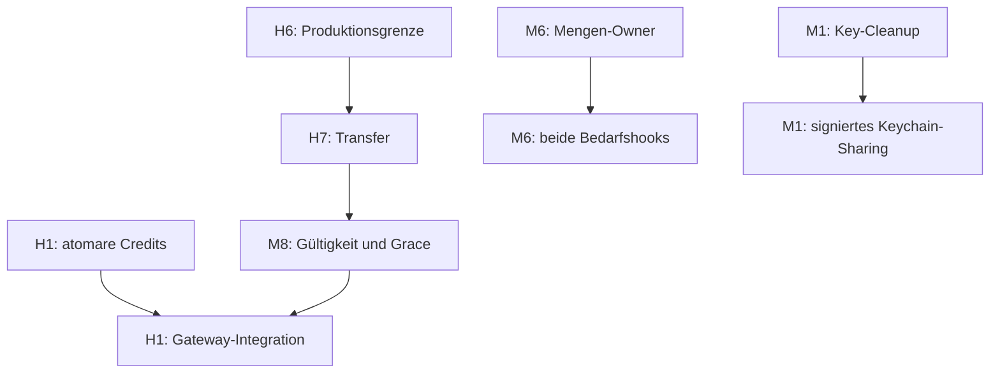

# Audit-Behebung: Übersicht der Einzelpläne

Stand: 5. November 2026. Ausgangsaudit: `fam-aen4`.
Planaufteilung: `fam-h6op`; ursprüngliche Gesamtplanung: `fam-b0ig`.

Für 14 Audit-Befunde besteht weiterhin ein Einzelplan mit eigenem Bead. Die
Einzelpläne zu H2 und H5 wurden nach Abschluss der Arbeiten entfernt; ihre
Historie und Abnahme bleiben in den geschlossenen Beads `fam-r4ec` und
`fam-521t` nachvollziehbar. Die ausschließlich interne Werkzeuge unter `tools/`
betreffenden Befunde H3 und M7 wurden als nicht anwendbar aus der
Behebungsplanung entfernt. Größere Probleme behalten ihre kleinen
Umsetzungs-Beads innerhalb des jeweiligen Einzelplans.

Beads besitzt Status, Akzeptanzkriterien, Dateiscope und Nachweise. Diese
Datei ist die Übersicht. Die fachlichen Entscheidungen stehen im jeweiligen
Einzelplan; gemeinsame Regeln stehen im
[Arbeitsrahmen](/Volumes/Programme/github/family_app/fam/tasks/audit-remediation/workflow.md).
Der bestehende Dashboard-Plan `tasks/plan.md` bleibt unverändert.

## Historisch entfernte Einzelpläne

| Problem | Abschluss |
| --- | --- |
| H2 | Umsetzung und Abnahme abgeschlossen; geschlossener Bead `fam-r4ec` |
| H5 | Umsetzung und Abnahme abgeschlossen; geschlossener Bead `fam-521t` |

## Vorhandene Einzelpläne

| Problem | Eigener Plan | Zuständiger Bead | Phase |
| --- | --- | --- | --- |
| H4 | [Kind-Profil-Löschung nach Haushaltsaustritt sperren](/Volumes/Programme/github/family_app/fam/tasks/audit-remediation/h4-kind-profil-loeschrechte/plan.md) | `fam-qdjx` | 1 |
| M3 | [Demotion des einzigen Haushaltsadmins verhindern](/Volumes/Programme/github/family_app/fam/tasks/audit-remediation/m3-letzter-admin/plan.md) | `fam-1tju` | 1 |
| H1 | [AI-Gateway an Abo und Credits binden](/Volumes/Programme/github/family_app/fam/tasks/audit-remediation/h1-ai-gateway-zugriff/plan.md) | `fam-koxq` | 1 und 2 |
| H6 | [Sandbox und Produktionsberechtigungen trennen](/Volumes/Programme/github/family_app/fam/tasks/audit-remediation/h6-revenuecat-sandbox/plan.md) | `fam-fp4t` | 1 |
| H7 | [Kaufübertragungen korrekt abgleichen](/Volumes/Programme/github/family_app/fam/tasks/audit-remediation/h7-revenuecat-transfer/plan.md) | `fam-nl7e.1` | 2 |
| M8 | [Abo-Zugriff bei verlorenen Ablaufereignissen begrenzen](/Volumes/Programme/github/family_app/fam/tasks/audit-remediation/m8-abo-gueltigkeit/plan.md) | `fam-nl7e.2` | 2 |
| H8 | [Gesamten Einkaufsabschluss atomar speichern](/Volumes/Programme/github/family_app/fam/tasks/audit-remediation/h8-einkaufsabschluss/plan.md) | `fam-o1f1` | 3 |
| H9 | [Offline-Änderungen beim manuellen Logout erhalten](/Volumes/Programme/github/family_app/fam/tasks/audit-remediation/h9-offline-logout/plan.md) | `fam-ncux` | 3 |
| M1 | [SQLCipher-Schlüssel sicher löschen und teilen](/Volumes/Programme/github/family_app/fam/tasks/audit-remediation/m1-sqlcipher-schluessel/plan.md) | `fam-pbd8` | 3 und 5 |
| M2 | [Account-Löschung für Receipt-Autoren ermöglichen](/Volumes/Programme/github/family_app/fam/tasks/audit-remediation/m2-receipt-autoren-loeschen/plan.md) | `fam-i0om` | 3 |
| M4 | [Erwachsenengewicht von Kind-Einträgen trennen](/Volumes/Programme/github/family_app/fam/tasks/audit-remediation/m4-erwachsenen-gewicht/plan.md) | `fam-vyb2` | 4 |
| M5 | [Tatsächliche Feature-Queries nach Sync invalidieren](/Volumes/Programme/github/family_app/fam/tasks/audit-remediation/m5-sync-query-keys/plan.md) | `fam-ninv` | 4 |
| M6 | [Packungsmaße im Einkaufsbedarf berücksichtigen](/Volumes/Programme/github/family_app/fam/tasks/audit-remediation/m6-packungsmengen/plan.md) | `fam-n71d` | 4 |
| L1 | [Session-Fragment auf der Bestätigungsseite entfernen](/Volumes/Programme/github/family_app/fam/tasks/audit-remediation/l1-bestaetigungs-fragment/plan.md) | `fam-9qox` | 4 |

`fam-nl7e.1` besitzt H7, `fam-nl7e.2` besitzt M8. Der Eltern-Bead
`fam-nl7e` dient weiter der Zusammenfassung dieser getrennten Probleme.

## Empfohlene Reihenfolge

| Phase | Schwerpunkt |
| --- | --- |
| 1 | H4, M3, atomare Credit-Grundlage aus H1 und H6 |
| 2 | H7 → M8 → Gateway-Integration aus H1 |
| 3 | H8, H9, Schlüssel-Cleanup aus M1 und M2 |
| 4 | M4, M5, M6 und L1 |
| 5 | Native Keychain-Abnahme aus M1 und Abschlussabnahme |

Die Phasen sind Prioritäten. Unabhängige kleine Korrekturen benötigen keinen
künstlichen Abschluss aller vorigen Phasen.

## Verbindliche Abhängigkeiten

Die zugehörigen Beads-Abhängigkeiten bleiben erhalten. Innerhalb von H1, M1
und M6 erklären die eigenen Pläne die Reihenfolge der Teilaufgaben.

## Kontrollpunkte

| Bead | Abnahme |
| --- | --- |
| `fam-1e31` | Haushaltsrechte und Kostenbudgets |
| `fam-f98c` | vollständiger Zahlungs- und AI-Zugriffspfad |
| `fam-o9ze` | Account-Wechsel und lokale Datensicherheit |
| `fam-aja5` | alle Audit-Befunde nachgewiesen behoben |

Der Abschluss verlangt Nachweise für alle verbleibenden Audit-Befunde.
Ungeklärte Risiken oder fehlende native/betriebliche Voraussetzungen bleiben
offen. Die Planaufteilung selbst schließt keinen Fehlerbehebungs-Bead.
